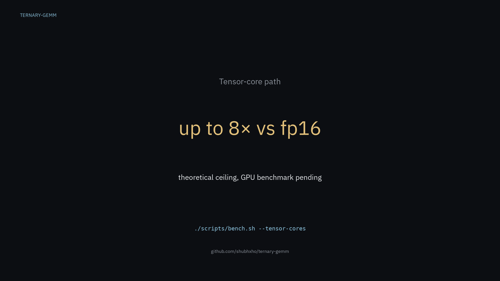
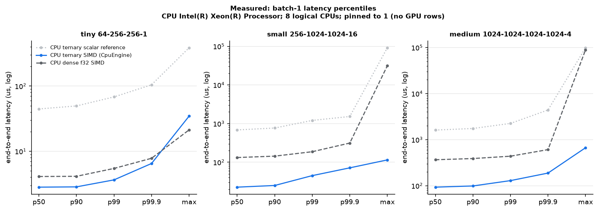
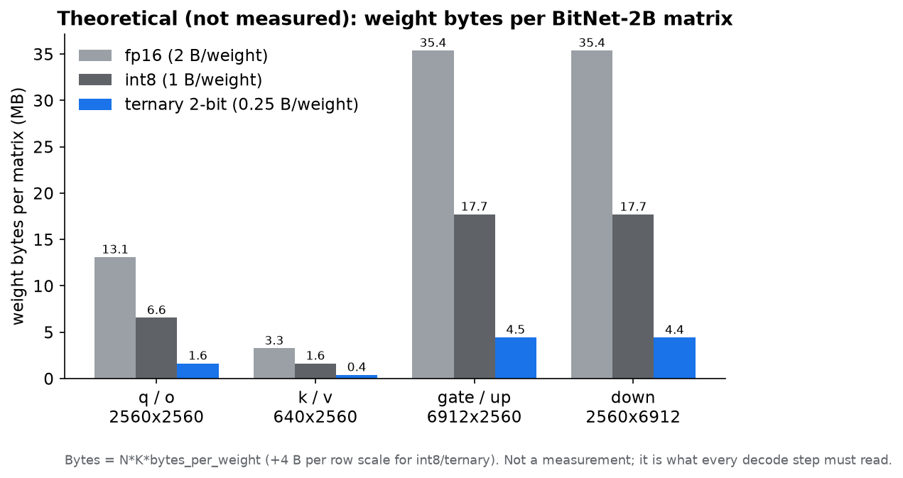
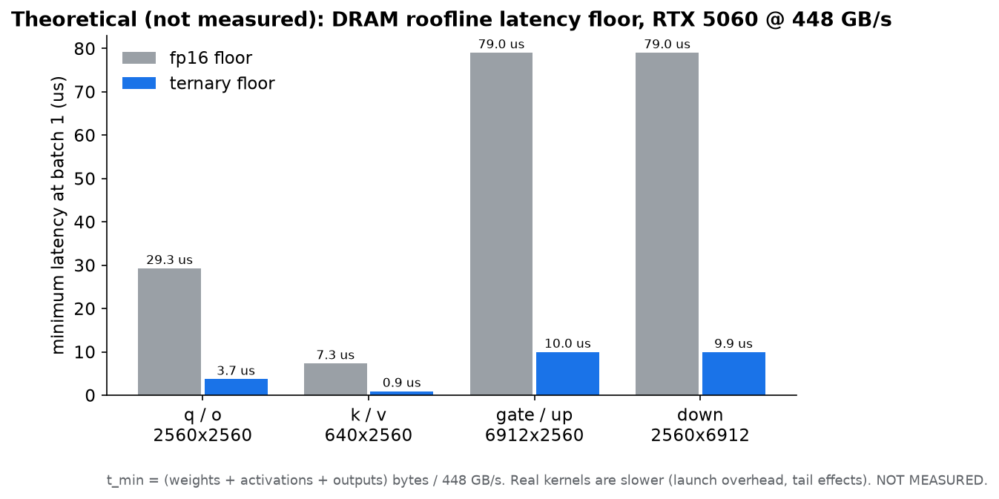
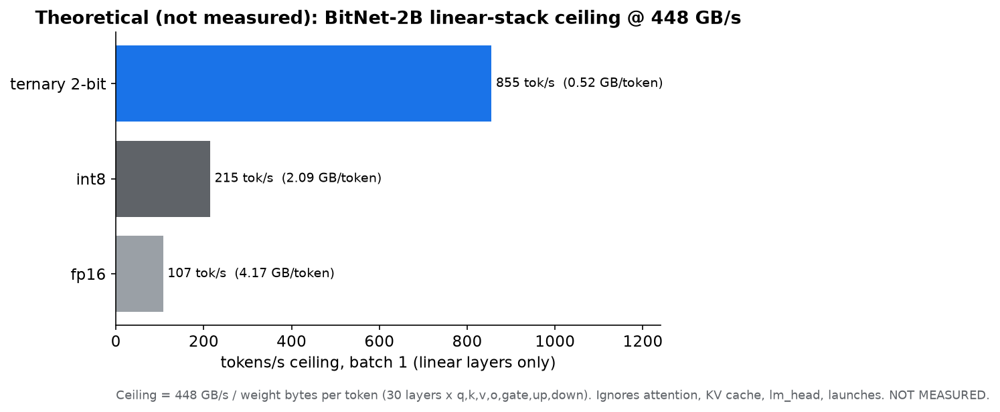

# ternary-gemm

[](https://github.com/shubhxho/ternary-gemm/actions/workflows/ci.yml)

Fused **ternary matmul kernels for LLM decode on NVIDIA GPUs**, written in Rust and CUDA. The weights follow BitNet b1.58: each one is in {-1, 0, +1} and stored in 2 bits.

* **W2A8**: 2-bit weights × int8 activations using BitNet's per-token absmax scheme. It runs as a GEMV for batch 1 and a small-batch GEMM for batch 1–16. Activation quantization and an optional RMSNorm can be **fused into the prologue**, and the scale and residual add are **fused into the epilogue**.
* **W2A16**: 2-bit weights × fp16 activations, accumulated in fp32.
* A safe Rust API on top of [`cudarc`](https://crates.io/crates/cudarc). The kernels are compiled at runtime with NVRTC, so **no CUDA toolkit or nvcc is needed to build**.
* A pure-Rust CPU reference. On the int8 path the GPU output is designed to be **bit-identical** to it.
* Benchmarks against **cuBLAS FP16** and a **naive ternary kernel**, timed with CUDA events.
* A **latency-first path for small signal models** (e.g. a market-feature vector scored by a few-layer ternary MLP at batch 1). It runs the whole MLP in one kernel, with pinned memory, CUDA-graph replay on a high-priority stream and an experimental persistent kernel. There is also an allocation-free **AVX2 CPU engine**, plus a tail-latency benchmark (p50 to p99.9, max, jitter histograms). See [For quant / HFT](#for-quant--hft-small-signal-models-at-batch-1).

> **Status: no GPU numbers have been measured yet.** The kernels compile with NVRTC 12.8, and `ptxas` assembles them for sm_80, sm_86, sm_89, sm_90 and sm_120. The CPU reference and a lane-by-lane emulation of the kernel index math pass on the CPU. The machine this was written on has **no GPU**, so every GPU latency or bandwidth figure below is either **NOT MEASURED** or explicitly a **theoretical estimate**. Run `./scripts/bench.sh` on a real GPU to fill them in.


## What else is in the repo

| area | what | docs |
|---|---|---|
| CPU backend | `cpu::CpuTernary`: bit-exact W2A8 GEMM for any batch, SIMD (AVX2 / AVX-512 VNNI), threaded; fast bit-exact activation quantizer | [ARCHITECTURE](docs/ARCHITECTURE.md) |
| Looped transformer | `looped`: one weight-shared ternary block applied N times, input injection (none / add / adapter), adaptive halting, CPU + GPU backends | [LOOPED](docs/LOOPED.md) |
| Tensor-core path | sm_80+ `mma.sync` backend: unpack 2-bit weights into int8/fp16 fragments (TriRun / BitBLAS style), selectable in the dispatcher and autotuner. 8× vs fp16 at batch 1 is a theoretical ceiling, not a measured GPU number | [TENSOR_CORES](docs/TENSOR_CORES.md), [report](docs/reports/tensor-core-ternary.md) |
| RTX 5090 / sm_120 | `tuning` (cited arch profiles, occupancy + roofline model), `autotune` (times model-ranked configs on the device), `roofline` / `autotune` binaries, sm_120 NVRTC checks | [RTX5090](docs/RTX5090.md) |
| Energy | `energy`: RAPL + NVML counters, J/inference and inferences/J in `latency --energy` | [ENERGY](docs/ENERGY.md) |
| Model conversion | `convert` feature: safetensors (f32/f16/bf16) -> `.tgm` (checksummed container) | [ARCHITECTURE](docs/ARCHITECTURE.md) |
| Python | pyo3 bindings + PyTorch custom-op stub in `bindings/python` | [bindings/python](bindings/python/README.md) |
| FPGA | multiplier-free ternary dot/MAC RTL, HLS C++ kernel, self-checking testbenches (Icarus, Verilator, g++) | [HARDWARE](docs/HARDWARE.md) |
| Results | schema-versioned JSON results, `scripts/compare_results.py` regression check | [results-schema.json](docs/results-schema.json) |
| Quality | proptest, cargo-fuzz targets, criterion benches, CI (fmt, clippy matrix, Linux/macOS tests, MSRV 1.88, rustdoc, NVRTC sm_80..sm_120, cargo-deny, ruff, hardware, Python, package) | [CONTRIBUTING](CONTRIBUTING.md) |
| Kernel tooling | `third_party/linux` submodule (shallow, not fetched by default) for perf / turbostat / RAPL work | [LINUX](docs/LINUX.md) |

### Tensor-core path (sm_80+)

A selectable backend unpacks the 2-bit natural-layout weights into int8 or fp16 `mma.sync` fragments. The 8× vs fp16 figure at batch 1 is the **theoretical bandwidth ceiling** (2-bit vs 16-bit weight traffic), not a measured GPU result. Prior art that reached near that ceiling on GEMV: [TriRun](https://github.com/NolanoOrg/TriRun) and [BitBLAS](https://github.com/microsoft/BitBLAS). On an sm_80+ GPU, measure it with `./scripts/bench.sh --tensor-cores`.

[](docs/media/tensor-core-explainer.mp4)

32-second explainer ([video](docs/media/tensor-core-explainer.mp4), [GIF](docs/media/tensor-core-explainer.gif)). Docs: [TENSOR_CORES](docs/TENSOR_CORES.md). Technical report (Connectionism-style): [Markdown](docs/reports/tensor-core-ternary.md) · [HTML](docs/reports/tensor-core-ternary.html).

### Cargo features

| feature | default | enables |
|---|---|---|
| `cuda` | yes | `gpu`, `signal`, `autotune`, GPU binaries (`cudarc`, dynamic loading: no toolkit needed to build) |
| `avx2` | yes | x86 SSE4.1/AVX2 SIMD paths (runtime-detected) |
| `avx512` | no | AVX-512 VNNI dot products (implies `avx2`; needs rustc >= 1.89) |
| `convert` | no | safetensors -> `.tgm` converter (`convert` binary) |
| `nvml` | no | GPU energy via NVML (dlopen) |

`cargo build --no-default-features` gives a portable, CPU-only build with no CUDA code at all.

## Quick start (on the GPU machine, e.g. an RTX 5060)

```bash
git clone https://github.com/shubhxho/ternary-gemm && cd ternary-gemm
./scripts/bench.sh            # build -> GPU tests -> GEMM benchmarks + signal-model latency -> results/*.{md,csv,png}
./scripts/bench.sh --quick    # batches 1 and 16 only
./scripts/latency_cpu.sh      # signal-model latency on the CPU only (no GPU needed)
cargo run --release --example signal_model   # synthetic market-feature loop
```

You need an NVIDIA driver (RTX 50-series needs driver ≥ 570 and CUDA ≥ 12.8 for sm_120) and Rust from [rustup](https://rustup.rs). You also need `libnvrtc` and `libcublas` from CUDA 12.x. If they aren't installed, the script pip-installs the CUDA 12.8 runtime wheels into `.venv-cuda/`. The script fails instead of skipping if no GPU is found (it sets `TERNARY_REQUIRE_GPU=1` for the tests).

On Windows (native, with CUDA Toolkit 12.8+ installed):

```powershell
$env:TERNARY_REQUIRE_GPU=1; cargo test --release -- --test-threads=1
cargo run --release --bin bench > results\my-gpu.md
```

Options: `cargo run --release --bin bench -- --batches 1,4 --layers 30 --no-verify`. Set `PEAK_GBPS=448` to override the peak bandwidth used for the "% of peak" column. By default it comes from the driver's memory-clock and bus-width attributes, which can be wrong on GDDR7 boards. The RTX 5060 spec is 448 GB/s: 128-bit bus at 28 Gbps.

Checks that need no GPU:

```bash
cargo test --release                          # CPU reference + kernel-index emulation (GPU tests auto-skip)
PTXAS=/path/to/ptxas cargo run --release --bin compile_check   # NVRTC + ptxas for sm_80..sm_120: registers/spills
```

## Library use

```rust
use ternary_gemm::{gpu::{Gpu, Launch}, pack::{quantize_absmean, PackedTernary}};

let (w_t, scales) = quantize_absmean(&w_f32, n, k, /*per_row=*/ false); // BitNet absmean
let packed = PackedTernary::from_ternary(&w_t, n, k, scales)?;           // K % 64 == 0
let gpu = Gpu::new(0)?;                     // compiles kernels for this GPU via NVRTC
let w = gpu.upload_weights(&packed)?;
let x = gpu.upload_f16(&x_host)?;           // [batch][k] fp16
let mut y = gpu.alloc_f16(batch * n)?;
// one launch: RMSNorm(gamma) -> absmax int8 quant -> ternary GEMV -> * scale -> + residual -> fp16
gpu.gemm_i8_fused(&w, &x, batch, Some(&gamma), 1e-5, Some(&residual), &mut y, Launch::default())?;
```

To hide launch overhead, record a whole decode step once and replay it as a CUDA graph:

```rust
let graph = gpu.capture(|| {            // launches only: no allocation, no host copies, no sync
    gpu.gemm_i8_fused(&w, &x, batch, Some(&gamma), 1e-5, None, &mut y, Launch::default())?;
    Ok(())
})?;
graph.launch()?;                        // replays every launch in one call; buffer addresses are baked in
```

Each call checks every buffer length and shape before launching, so bad input returns an error instead of reading or writing out of bounds.

## For quant / HFT: small signal models at batch 1

The LLM kernels above are built for throughput on big matrices. A trading model is the opposite case: a few hundred features, a few small layers, one request at a time, where **p99 and max latency matter more than throughput**. This path is built for that case.

```rust
use ternary_gemm::{gpu::Gpu, mlp::{Act, CpuEngine, TernaryMlp}, signal::{SignalEngine, PersistentEngine}};

let model = TernaryMlp::from_f32(&[64, 256, 256, 1], &weights, &biases, Act::Relu)?; // absmean -> ternary
let mut cpu = CpuEngine::new(&model)?;            // AVX2, zero allocations per call
cpu.forward_into(&features, &mut signal);

let gpu = Gpu::new(0)?;                            // highest-priority stream
let mut eng = SignalEngine::new(&gpu, &model, 1, None)?;  // preallocates + captures one CUDA graph
eng.infer(&features, &mut signal)?;                // pinned H2D -> whole-MLP kernel -> D2H, spin-wait
let mut p = PersistentEngine::start(&gpu, &model, None)?; // EXPERIMENTAL: resident kernel + doorbell
p.infer(&features, &mut signal)?;
```

What it does:
* **One launch for the whole model.** `ternary_mlp` keeps activations in shared memory between layers, re-quantizing them to int8 after each layer. Weights use a k-major layout, so the warp's loads coalesce and activation reads are shared-memory broadcasts. Any depth works; widths go up to 4096 and K must be a multiple of 16. `batch > 1` runs one block per sample.
* **Nothing allocates on the hot path.** Device buffers and page-locked host staging buffers are allocated once, in `new()`. A request is `copy into pinned buffer → graph launch → spin on cuStreamQuery → read pinned output`: one driver call to submit and none to allocate. `Wait::Block` and `Submit::Direct` exist for comparison.
* **Persistent mode (experimental).** One block stays resident and spins on a doorbell in mapped pinned host memory. It reads the features and writes the signal zero-copy over PCIe, so there is no launch and no memcpy call. The cost is one SM and one host core busy-waiting, and you must `stop()` it before synchronizing the whole context. It has a timeout, and on a stop failure the mapped buffers are leaked instead of freed, so a still-running kernel can't touch freed memory.
* **Bit-exact everywhere.** The CPU reference, the AVX2 `CpuEngine` (`vpmaddubsw` on the codes `w+1`, 4 rows per pass), a lane-level emulation of the CUDA kernel, and the GPU kernels (tested when a GPU is present) all produce the same bits.
* **Baselines in the same harness:** the scalar reference, a dense f32 AVX2+FMA matvec of the same model, and cuBLAS FP16 (dense fp16 weights, one GEMM plus one bias/activation kernel per layer, captured as a graph with the copies).

Measured on this repo's build machine (**CPU only**: Intel Xeon cloud VM, 8 vCPUs, AVX2, run pinned to one core with `taskset`; 50,000 requests per path after 5,000 warm-up; synthetic features, random untrained models). These are end-to-end per-request latencies in µs. The full report and charts are in [`results/20261122-025900-cpu-latency.md`](results/20261122-025900-cpu-latency.md).

| model (widths) | path | p50 | p99 | p99.9 | max |
|---|---|---|---|---|---|
| tiny 64-256-256-1 | ternary SIMD (`CpuEngine`) | 2.82 | 3.64 | 6.50 | 34.6 |
| tiny 64-256-256-1 | dense f32 AVX2 | 4.11 | 5.46 | 7.81 | 21.3 |
| small 256-1024-1024-16 | ternary SIMD (`CpuEngine`) | 22.63 | 44.98 | 71.49 | 114.7 |
| small 256-1024-1024-16 | dense f32 AVX2 | 132.20 | 186.96 | 313.24 | 31291.5 |
| medium 1024×4 layers → 4 | ternary SIMD (`CpuEngine`) | 92.95 | 128.87 | 187.89 | 667.7 |
| medium 1024×4 layers → 4 | dense f32 AVX2 | 365.91 | 436.94 | 607.71 | 89419.3 |



Re-measured after the AVX2 activation quantizer and the AVX-512 VNNI dot product landed (same VM, `--features avx512`, pinned to core 3, 20,000 requests per path after 2,000 warm-up; **CPU only**). Raw data: [`results/20261122-162423-cpu-latency-avx512.json`](results/20261122-162423-cpu-latency-avx512.json) (schema-validated; compare runs with `scripts/compare_results.py`).

| model (widths) | path | p50 | p99 | p99.9 | max |
|---|---|---|---|---|---|
| tiny 64-256-256-1 | ternary SIMD (`CpuEngine`, AVX-512 VNNI) | 2.28 | 3.03 | 4.10 | 11.7 |
| tiny 64-256-256-1 | dense f32 AVX2 | 4.79 | 6.24 | 9.97 | 23.0 |
| small 256-1024-1024-16 | ternary SIMD (`CpuEngine`, AVX-512 VNNI) | 18.30 | 22.57 | 31.66 | 41.0 |
| small 256-1024-1024-16 | dense f32 AVX2 | 147.78 | 177.21 | 218.49 | 565.2 |
| medium 1024×4 layers → 4 | ternary SIMD (`CpuEngine`, AVX-512 VNNI) | 80.60 | 104.60 | 121.20 | 171.2 |
| medium 1024×4 layers → 4 | dense f32 AVX2 | 471.50 | 517.37 | 615.66 | 16991.4 |

Max values on a shared VM include scheduler and hypervisor noise. On a tuned box (isolated cores, no frequency scaling) the tail should be tighter, but that has not been measured here. **GPU latency is NOT MEASURED**: the build machine has no GPU. `./scripts/bench.sh` on a GPU machine adds the GPU rows (graph + spin, direct, blocking sync, persistent, cuBLAS FP16) to the same tables and charts.

Honest positioning:
* This is an inference **kernel library**. It contains no strategy, no data, and no claim about trading performance. The models in the benchmarks are random.
* For tiny models, a good CPU path is often the right answer: no PCIe round trip, and it's already in the low µs. A GPU starts to pay off as models grow, or when many instruments are scored per tick (`batch > 1`). The benchmark is there to find where that crossover is on your hardware.
* None of these latency techniques is new. CUDA graphs, pinned/mapped memory, persistent kernels and spin-waiting are standard. Serious HFT stacks also use kernel-bypass NICs, FPGAs, isolated cores and pinned clocks, which are out of scope here.

## Design

### Weight format

* Each weight `w ∈ {-1,0,+1}` is stored as **code `c = w + 1 ∈ {0,1,2}`**, 2 bits each, 16 per `u32`, with one f32 scale per output row. BitNet's per-tensor scale is the case where every row has the same scale.
* **In-word interleave:** weight `16·kb + 4j + i` sits at bits `[8i + 2j, +2)`. So `(word >> 2j) & 0x03030303` gives four consecutive weights as four bytes, and the whole decode is **one shift plus one AND per 4 weights**, with no lookup table. Those bytes feed straight into `__dp4a` against four consecutive int8 activations.
* **Offset trick:** with codes in {0,1,2}, `Σ c·x = Σ w·x + Σ x`. The kernel subtracts the per-token `Σ x`, which is computed once during quantization. Codes therefore never need sign handling.
* **Chunk permutation:** a row is split into chunks of 128 words (2048 weights; the last chunk can be shorter). In a chunk of `Wc` words with `L = Wc/4` lanes, the word for k-block `q·L + lane` is stored at offset `4·lane + q`. Each lane makes **one 128-bit load per row per chunk**, so the warp reads 512 contiguous bytes. For each `q`, the active lanes read a **contiguous** run of activations, which means coalesced global loads and conflict-free shared-memory reads in the fused kernel.

Microsoft's BitNet GPU kernel uses the same basic decode-to-int8-then-dp4a idea with a different interleave; see the novelty notes below.

### Kernels (`kernels/ternary.cu`)

| kernel | what it does |
|---|---|
| `quantize_i8` | One block per token. Optional RMSNorm, then absmax, `s = 127/absmax`, `q = clamp(rint(x·s))` and `Σq`. |
| `ternary_i8_b{BT}_r{R}` | Main W2A8 loop. One warp computes `R ∈ {1,2,4}` rows for up to `BT ∈ {1,2,4,8,16}` tokens. Weights are decoded once into registers and reused across the batch. 16 `dp4a` per lane per row per token per chunk. Warp-shuffle reduction. Epilogue `(acc − Σq) / s · scale (+ residual)` with explicit `__fdiv_rn`, `__fmul_rn` and `__fadd_rn`, so there is no FMA contraction and the result is bit-exact against the CPU. |
| `ternary_i8_fused_b{BT}_r{R}` | Single launch. Each block re-quantizes the activations (fp16 → RMSNorm → int8) into shared memory, then runs the same loop. It trades redundant L2 reads of the small activation vector for one fewer launch and one fewer global round trip. Shared memory needed is `batch·K` bytes. At startup the fused kernels opt in to the device's large dynamic shared-memory carve-out (`MAX_SHARED_MEMORY_PER_BLOCK_OPTIN − 1 KiB`, ≈ 99 KiB on sm_86/89/120, ≈ 163 KiB on sm_80, ≈ 227 KiB on sm_90). If the driver refuses, the limit falls back to 47 KiB. The limit in use is `gpu.info.fused_smem_limit`. |
| `ternary_f16_b{BT}_r{R}` | W2A16. Each code byte is spliced under `0x4B000000`, giving the float `2²³ + c`, and `2²³ + 1` is subtracted, so decoding a weight is one `PRMT` plus one `FADD`. fp32 FMA accumulation. |
| `ternary_mlp`, `ternary_mlp_persistent` | Whole small MLP in one block (see *For quant / HFT*). K-major ternary words, int8 activations in shared memory, per-layer absmax re-quantization, `_rn` epilogue with bias and ReLU/ReLU². The persistent variant loops on a mapped-memory doorbell. |
| `f32_to_f16`, `bias_act_f16` | Glue for the cuBLAS FP16 MLP baseline. |
| `naive_i8`, `naive_f16` | Baselines: one thread per output, natural 2-bit layout, scalar decode and multiply, uncoalesced. |

The batch tile and rows-per-warp are template instantiations, 55 kernels in total. The benchmark sweeps `R` and reports the best one. The library default is a heuristic that picks the largest `R` that still gives at least 4 blocks per SM.

From `ptxas -v` (CUDA 12.8; full output in [`docs/compile_check_output.txt`](docs/compile_check_output.txt)): on sm_120, `ternary_i8_b1_r{1,2,4}` uses 38, 40 and 48 registers and `ternary_i8_b16_r{1,2,4}` uses 62, 108 and 204. Nothing spills on sm_90 or sm_120. On sm_80, sm_86 and sm_89, two variants spill up to 24 bytes (`ternary_f16_b4_r2`, plus `ternary_i8_fused_b2_r2` on sm_80).

### Why NVRTC at runtime rather than nvcc in `build.rs`

The kernels are compiled at first use, for the exact GPU (`compute_XY` of the device), then JIT-compiled to SASS by the driver. If the installed NVRTC doesn't know the GPU's architecture yet, the code falls back to older PTX targets. So `cargo build` works on any machine, even without CUDA, and the same binary targets sm_80, sm_120 and anything newer. The kernel file has **no `#include`**: fp16 is handled as raw bits with PTX `cvt`, so NVRTC needs no CUDA headers on disk.

### Correctness

* `tests/cpu_reference.rs`: the reference against direct dot products, BitNet quantization properties, and absmean weight quantization.
* `tests/kernel_emulation.rs`: a lane-by-lane Rust transliteration of both CUDA main loops (chunking, permutation, dp4a byte lanes, PRMT decode), checked against the reference at K = 64, 2048, 2560, 4096, 6912 and 11008. It **runs on the CPU**.
* `tests/tensor_core.rs`: unpacks the natural 2-bit layout into the same m16n8k16 fragments as the `mma.sync` kernels and checks a tiled GEMM against the reference. The int8 path is **bit-exact**. It **runs on the CPU**. The matching device tests in `tests/gpu.rs` are skipped when no GPU, or no sm_80+, is present.
* `tests/gpu.rs`: GPU against CPU for shapes 2560×2560, 640×2560, 6912×2560, 2560×6912, 11008×4096 and 4096×11008 (N×K), at batches 1, 3 and 16, with and without residual, for every `R`:
  * int8 quantization and all W2A8 kernels, including the naive one: **bit-exact**.
  * Fused RMSNorm: within 1% of max |y|. The GPU uses `rsqrtf` and a different summation order, so the int8 rounding of a few elements can differ by 1.
  * W2A16 and cuBLAS: within 0.2% and 1% of max |y|.
* `tests/mlp.rs` (CPU): for 5 model shapes × 3 activations × 4 input patterns (normal, tiny, outliers, all-zero), the AVX2 `CpuEngine` and a lane-level emulation of `ternary_mlp` both match the scalar reference **bit for bit**.
* `tests/gpu.rs::signal_models` (GPU): `SignalEngine` (graph and direct, batch 1 and 4, 128/default/1024 threads) and `PersistentEngine` (1,000 requests) bit-exact against the reference; cuBLAS FP16 within tolerance.
* The benchmark re-runs a correctness check before timing and labels any mismatch.

## Results

### Measured on a GPU

**NOT MEASURED.** No GPU was available where this was built: no `nvidia-smi`, no `libcuda`. Run `./scripts/bench.sh` and commit the report from `results/`.

The report contains:
* A correctness table.
* A per-shape table for cuBLAS FP16, naive ternary, W2A8 GEMV only, W2A8 quantize + GEMV, W2A8 fused and W2A16, at batches 1, 2, 4, 8 and 16. It gives latency in µs, effective GB/s, % of peak DRAM bandwidth and speedup over cuBLAS.
* A full **BitNet-b1.58-2B linear-layer stack**: 30 layers × (q, k, v, o, gate, up, down), comparing the ternary path with cuBLAS FP16 as linear-only tokens/s. Each path runs twice, launched op by op and replayed as one **CUDA graph**.
* The same numbers as CSV (`--csv`). `scripts/plot_results.py` turns the CSV into charts titled "Measured on <GPU>": latency and % of peak bandwidth per shape, plus layer-stack tokens/s.

For honest DRAM numbers, weights rotate through enough copies to exceed 3× the L2 size, the layer stack allocates all 30 layers' weights, and buffers are filled with random data, not zeros.

### Measured on the CPU (sanity only, not a GPU number)

When no GPU is found, `cargo run --release --bin bench` times the scalar CPU reference. On the 8-vCPU build box it took 16.4 ms for 2560×2560 and 42.5 ms for 2560×6912 at batch 1, single-threaded. This is an oracle and was deliberately left unoptimized.

### Theoretical estimate (NOT measured): DRAM roofline at batch 1, RTX 5060 at 448 GB/s




`t_min = bytes / 448 GB/s`. fp16 moves 2 bytes per weight and 2-bit ternary moves 0.25 bytes per weight, so **weight traffic is exactly 8× smaller**. Activations, outputs and per-row scales bring the total ratio slightly under 8.

| shape (N × K) | fp16 bytes | ternary bytes | t_min fp16 (µs) | t_min ternary (µs) | ideal ratio |
|---|---|---|---|---|---|
| 2560 × 2560 | 13.12 MB | 1.66 MB | 29.3 | 3.7 | 7.91× |
| 640 × 2560 | 3.28 MB | 0.42 MB | 7.3 | 0.9 | 7.84× |
| 6912 × 2560 | 35.41 MB | 4.47 MB | 79.0 | 10.0 | 7.92× |
| 2560 × 6912 | 35.41 MB | 4.45 MB | 79.0 | 9.9 | 7.95× |
| 11008 × 4096 | 90.21 MB | 11.35 MB | 201.4 | 25.3 | 7.95× |
| 4096 × 11008 | 90.21 MB | 11.32 MB | 201.4 | 25.3 | 7.97× |

For the whole BitNet-2B linear stack, 30 × 69.5 M weights are 4.17 GB in fp16 against 0.52 GB in ternary. That puts the bandwidth ceiling at ≈ 107 tokens/s for fp16 and ≈ 855 tokens/s for ternary at batch 1 (`1 / (bytes / 448 GB/s)`).



All three charts come from `scripts/make_doc_charts.py` and are pure arithmetic. They are labeled **Theoretical (not measured)**.

These are **upper bounds**, not predictions. Several things will keep the real speedup below 8×:
* Small ternary GEMVs, at 1–10 µs ideal, are close to **kernel-launch overhead** of a few µs each. The layer stack issues 11 launches per layer. The benchmark also times a CUDA-graph replay to measure how much of that overhead graphs remove.
* The tail chunk, where K is not a multiple of 2048, idles some lanes.
* cuBLAS is near roofline on large shapes.
* On small shapes where fp16 weights fit in L2, cuBLAS also benefits if the cache isn't flushed. The benchmark prevents this by rotating weight copies.

Microsoft reports 1.3×–3.6× over BF16 for its W2A8 GEMV on an A100. Expect something in that range, not 8×, until it's measured.

## Novelty check: has someone already done this? (searched Nov 2026)

**Verdict: yes, mostly.** A Rust + CUDA ternary (BitNet b1.58) decode engine with a fused RMSNorm → int8 quantization kernel, bit-exact checks against a scalar reference, and measured consumer-GPU numbers already exists: **[Quitetall/tritium](https://github.com/Quitetall/tritium)**. It is Apache-2.0, has a `tritium-cuda` crate (`rmsnorm_quant_i8`, TQ2_0 IMMA kernels, built with nvcc), and its authors report ~280–300 tok/s end-to-end for BitNet-2B4T on an RTX 4090 ([r/LocalLLaMA post](https://www.reddit.com/r/LocalLLaMA/comments/1vbf0nt/)). The core trick (2-bit pack → int8 → `dp4a`) is also in Microsoft's own BitNet GPU kernel. This repo is **not a first**.

What is narrower or different here:
* It is a **small standalone kernel crate**, not a whole inference engine.
* Kernels are compiled at runtime with **NVRTC**, so building needs no nvcc and no CUDA toolkit.
* RMSNorm and quantization are fused into **the same launch as the GEMV**, along with the residual add in the epilogue.
* It handles **any N, any K % 64, and batch 1–16**.
* It ships a cuBLAS-FP16 / naive / CUDA-graph **comparison harness** with CSV output and charts.
* Weakness: **no measurements yet**. Tritium and Cortex-Bitnet both publish real numbers.

| project | what it is | relation to this repo |
|---|---|---|
| [Quitetall/tritium](https://github.com/Quitetall/tritium) | Rust BitNet inference engine with CUDA kernels (`crates/tritium-cuda`): fused RMSNorm + int8 quantization, ternary IMMA/dp4a paths, bit-identical to a scalar reference. Reports ~280–300 tok/s on an RTX 4090. | **Closest prior art.** It does more (a full model) and is measured. This repo is a smaller, NVRTC-only kernel library with fused quant+GEMV in one launch. |
| [Tabakkui/Cortex-Bitnet](https://github.com/Tabakkui/Cortex-Bitnet) ([post](https://www.reddit.com/r/OpenAssistant/comments/1v8veh2/)) | Custom CUDA ternary engine (Python host, sm_86): fused FFN/RMSNorm, CUDA graphs, int8 lm_head. Reports 206–217 tok/s for BitNet-2B on an RTX 3070. PolyForm Noncommercial. | Same goals and also measured. Not Rust. |
| [microsoft/BitNet `gpu/`](https://github.com/microsoft/BitNet/tree/main/gpu) ([bitnet.cpp paper](https://arxiv.org/abs/2502.11880)) | CUDA W2A8 GEMV: 2-bit interleave → int8 → `dp4a`. M = 1 only, hard-coded shapes, quantization done separately in PyTorch. Reports 1.3–3.6× over BF16 on an A100. | Same core idea. This repo adds arbitrary shapes, batch 1–16, fused prologue and epilogue, and Rust with no nvcc. |
| [microsoft/BitBLAS](https://github.com/microsoft/BitBLAS) (Ladder, OSDI '24) | TVM-generated INT2×INT8 GEMV/GEMM. | Likely a stronger baseline. Not benchmarked here yet. |
| [Spectra-1.1 / TriRun](https://arxiv.org/abs/2506.23025), [TernaInfer](https://github.com/Gu-J/TernaInfer) (DAC 2026), [BITCOS](https://arxiv.org/abs/2609.16338) (Intel Xe2) | Research ternary kernels: FP16×INT2 tensor-core, FPGA/accelerator-style, Intel GPU. | Different hardware paths. |
| llama.cpp `TQ1_0` / `TQ2_0` | Ternary GGUF; CUDA `TQ2_0` PRs ([#11183](https://github.com/ggml-org/llama.cpp/pull/11183), draft [#30278](https://github.com/ggml-org/llama.cpp/pull/30278)) still unmerged. | Inference engine, not a library. |
| Other Rust work: [`bitnet-quantize`](https://docs.rs/bitnet-quantize) and `tritter-accel` (CubeCL), [nanochat-rs-ternary](https://github.com/architehc/nanochat-rs-ternary) (claims a CUDA dp4a decode path), [tidynest/bitnet-toy](https://github.com/tidynest/bitnet-toy) (cudarc + NVRTC training, cuBLAS int8), [burn](https://github.com/tracel-ai/burn) (absmean + packed 2-bit quantization), [candle #1956](https://github.com/huggingface/candle/issues/1956) (BitNet still open) | Rust ternary/BitNet pieces at various depths. | I didn't run or benchmark them. |
| [microsoft/T-MAC](https://github.com/microsoft/T-MAC) | Lookup-table low-bit GEMM, CPU only. | Different hardware. |

## Limitations

* **Signal-model path:** widths are at most 4096 and K must be a multiple of 16 (zero-pad features). One block per sample means a single SM does all the work, which is right for latency on small models but caps large layers at one SM's bandwidth. The persistent engine is batch 1 only, experimental and untested on hardware. Its host↔device ordering relies on x86 TSO plus `__threadfence_system`. `CpuEngine` stores one byte per weight, so models over the L2 size become memory-bound; a 2-bit in-register decode for the CPU is not implemented. The dense f32 baseline is a straightforward AVX2+FMA matvec, not MKL or oneDNN.

* **No GPU measurements yet**, as described above.
* GPU kernels need `K` to be a multiple of 64 (zero-pad with `pack::pad_k` / `pad_k_acts`, which is exact) and batch 1–16 per launch (chunk larger batches, or use `cpu::CpuTernary`, which takes any batch). This is decode-oriented. A tensor-core path (`mma.sync`, sm_80+) is available for those same shapes as a selectable backend; there is still no dedicated large-batch prefill kernel, and **no GPU number for it has been measured**.
* Scales are per row (or per tensor), with no per-group scales.
* The fused kernel needs `batch·K` bytes of shared memory, up to the opt-in limit (≈ 99 KiB on consumer GPUs, so batch ≤ 9 at K = 11008). Above that, use `quantize` plus `gemm_i8`. A large carve-out lowers occupancy; whether fused still wins at big batch·K is unmeasured.
* There is no split-K, so very small `N` with very large `K` underfills the GPU.
* CUDA graph capture (`Gpu::capture`) is untested on hardware, like everything else on the GPU side. If capture fails, the benchmark prints `n/a` with the error and carries on.
* The layer-stack benchmark is linear layers only. It leaves out attention, the activation function, embeddings and lm_head.
* Not yet compared against BitBLAS, the BitNet GPU kernel, or llama.cpp on the same GPU.

## Layout

```
kernels/ternary.cu        dp4a / fused CUDA kernels (NVRTC, no includes)
kernels/tensor_core.cu    sm_80+ mma.sync path (NVRTC, no includes)
src/pack.rs               absmean quantization, 2-bit packing (permuted + natural layouts)
src/reference.rs          CPU reference (oracle)
src/tensor_core.rs        CPU reference for the tensor-core path (fragment unpack + tiled GEMM)
src/gpu.rs                safe cudarc wrapper, cuBLAS baseline, CUDA-event timer, Backend::TensorCore
src/bin/bench.rs          benchmark -> Markdown report (+ --csv)
src/mlp.rs                small ternary MLP (signal model): reference, AVX2 CpuEngine, dense f32 baseline
src/signal.rs             GPU latency engines: SignalEngine (graph + pinned), PersistentEngine, CublasMlp
src/bin/latency.rs        batch-1 end-to-end latency benchmark (p50..max, histograms, CSV)
examples/signal_model.rs  synthetic feature-stream inference loop
src/bin/compile_check.rs  NVRTC + ptxas register/spill report (no GPU needed)
src/cpu.rs                CPU W2A8 backend (any batch, SIMD, threads) + fast bit-exact quantizer
src/looped.rs             looped (weight-shared) ternary transformer, CPU + GPU backends
src/tuning.rs             arch profiles (RTX 5090 first), occupancy model, roofline projection
src/autotune.rs           runtime autotuner (feature cuda) + src/bin/autotune.rs
src/bin/roofline.rs       projected bounds + modelled configs for any profile (no GPU)
src/energy.rs             RAPL / NVML energy counters
src/results.rs            environment capture + JSON results writer
src/format.rs, convert.rs .tgm container, safetensors converter (+ src/bin/convert.rs)
tests/                    CPU reference, kernel emulation, tensor_core, MLP, CPU backend, properties,
                          looped, format, convert, energy (CPU); gpu, looped_gpu (GPU); nvrtc_sm120 (NVRTC)
benches/cpu.rs            criterion benchmarks (quantize, signal models, packing, looped)
fuzz/                     cargo-fuzz targets (.tgm parser, pack roundtrip, SIMD quantize)
hw/                       FPGA skeleton: RTL, HLS C++, testbenches, Makefile
bindings/python/          pyo3 bindings, PyTorch op stub, pytest
third_party/linux         kernel submodule (shallow, update = none)
docs/                     ARCHITECTURE, LOOPED, RTX5090, ENERGY, HARDWARE, LINUX, TENSOR_CORES,
                          results schema, reports/tensor-core-ternary.{md,html}, media/
scripts/bench.sh          one-shot build + verify + benchmark + measured charts
                          (`--tensor-cores` also times the mma.sync path)
scripts/make_tensor_core_media.py  explainer video, poster, GIF, report figures
scripts/latency_cpu.sh    CPU-only latency run (no GPU needed) + charts
scripts/plot_latency.py   latency CSV -> tail-percentile and histogram charts
scripts/plot_results.py   bench CSV -> results/*.png ("Measured on <GPU>")
scripts/make_doc_charts.py  docs/img/*.png (theoretical charts + data-flow diagram)
scripts/compare_results.py  validate results JSON against the schema, regression compare
scripts/linux_tools.sh    fetch the kernel submodule, build perf + turbostat
```

License: MIT.
