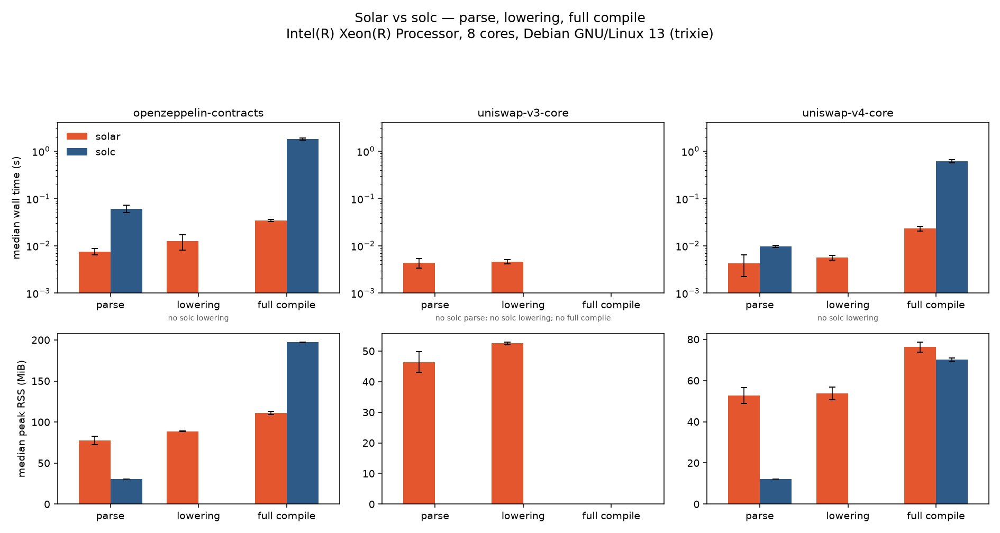

# Solar vs solc compiler benchmark

A reproducible harness that builds [Paradigm Solar](https://github.com/paradigmxyz/solar) from a pinned commit, downloads a pinned [`solc`](https://github.com/argotorg/solidity) binary, fetches pinned Solidity corpora (not vendored in git), and measures **parse**, **lowering**, and **full compile** wall time plus peak RSS on this machine.

This sits next to the ternary-gemm kernel work because the same performance-engineering loop — pin the tools, measure the real compiler, report median and tail — is how Speall looks at HFT and crypto infrastructure. Solidity tooling is the overlap: trading firms ship and verify a lot of Solidity, and a compiler that is both faster and leaner is part of that stack.

The latest measured numbers from this box are in [results.md](results.md), [results.json](results.json) and [chart.png](chart.png). Every figure in those files was measured here. Nothing is estimated.

## Run it

```bash
# From the repo root. Needs Rust (cargo/rustc), Python 3, matplotlib,
# hyperfine, GNU time, curl and git. setup.sh will apt-install hyperfine
# and time if they are missing and sudo works.
./bench/solar/run.sh
```

Or step by step:

```bash
./bench/solar/fetch_corpus.sh   # shallow-clones pinned corpora into bench/solar/.corpus/ (gitignored)
./bench/solar/setup.sh          # builds Solar from source, downloads solc into bench/solar/.tools/
python3 ./bench/solar/run_bench.py
```

Environment overrides: `CORPUS_DIR`, `TOOLS_DIR`, `SOLAR_PREBUILT`, `SOLAR_BIN`, `SOLC_BIN`, `SOLAR_THREADS`, `BENCH_WARMUP` (default 3), `BENCH_RUNS` (default 20), `BENCH_FULL_WARMUP` (default 2), `BENCH_FULL_RUNS` (default 10), `BENCH_MEM_RUNS` (default 10).

## What is measured

Each job feeds the **same Standard JSON** input to Solar and solc (sources inlined, remappings applied, optimizer off). The JSON path is passed as a file argument and timed with `hyperfine --shell=none`, so bash startup does not dominate the short parse runs. Compiler stdout is still produced (hyperfine reads and discards it); we are not timing disk writes.

| stage | Solar | solc | meaning |
|---|---|---|---|
| parse | `settings.stopAfter=parsing` | `settings.stopAfter=parsing` | lex, parse, import resolution |
| lowering | `settings.stopAfter=lowering` | not compared — solc has no equivalent stage | AST → HIR, inheritance, name resolution, basic type checking |
| full compile | no `stopAfter`; bytecode requested | same, with `viaIR=true` (see caveats) | frontend plus codegen, optimizer off |

Wall time comes from [hyperfine](https://github.com/sharkdp/hyperfine) (median and p95 over the recorded runs, after warmup). Peak RSS comes from a separate GNU `time %M` pass (median and p95, kibibytes on Linux).

Solar is given `--threads` equal to the machine's logical CPUs, which is its default. solc's Standard JSON pipeline is effectively single-threaded.

## Pins

See [pins.env](pins.env). The measurement in this directory used:

- Solar `f1b75c64ec466637d9040418268b365211d0e939` (0.3.0-dev, main as of 2026-11-20)
- solc `0.8.39` (official `solc-static-linux` binary)
- OpenZeppelin Contracts `v5.7.0` (`cab19933c33c2ad1d4c7a84864a3601dddfd16f3`)
- Uniswap v3-core `v1.0.0` (`e3589b192d0be27e100cd0daaf6c97204fdb1899`)
- Uniswap v4-core `v4.0.0` (`e50237c43811bd9b526eff40f26772152a42daba`)
- solmate `4b47a19038b798b4a33d9749d25e570443520647` (the `lib/solmate` submodule of v4-core v4.0.0), fetched only to resolve `src/ProtocolFees.sol`

The production trees are used: OpenZeppelin `contracts/` minus `mocks/`, Uniswap v3 `contracts/` minus `test/`, Uniswap v4 `src/` minus `test/`, plus the solmate import closure.

## Caveats

These are also written into `results.md` next to the numbers:

- The box is a KVM VM. The kernel reports a generic `Intel(R) Xeon(R) Processor` at 2400 MHz with no cpufreq sysfs, so turbo behaviour is unknown.
- solc full compile uses `viaIR=true`. Without it, solc 0.8.39 fails the OpenZeppelin corpus with "Stack too deep", and Uniswap v4-core's own Foundry config is via-IR. Solar compiles the same input on its native pipeline.
- Uniswap v3-core targets Solidity `=0.7.6`. The pinned solc 0.8.39 rejects that pragma, so v3 has no solc numbers. Solar parses and lowers the production sources, but analysis and codegen fail on 0.7-style implicit integer conversions; those stages are omitted rather than reported as times.
- Uniswap v4-core's `PoolManager.sol` pins `pragma solidity 0.8.26;`, which solc 0.8.39 rejects. For solc only, that exact 0.8.x pragma is widened to `^0.8.26`. Solar is given the original sources. No 0.7.x pragmas are rewritten.
- Stage control uses Standard JSON `settings.stopAfter`. Solar's CLI `--stop-after` is not honoured in `--standard-json` mode on this pin, so it is not used.
- This is not a replay of a project's production optimizer-runs setting (v4-core uses 44,444,444 runs and via-IR).


## Latest measured results

Measured on 2026-11-22 16:54:36 IST (Asia/Calcutta), on an 8-core `Intel(R) Xeon(R) Processor` (family 6, model 207, stepping 2, kernel-reported 2400 MHz) with 15.63 GiB RAM, Debian GNU/Linux 13, Linux 6.12.113+, KVM. Full machine notes, caveats and raw samples are in [results.md](results.md) and [results.json](results.json). Chart: [chart.png](chart.png).



## Wall time

Median and p95 over hyperfine runs (parse/lowering: 20 runs after 3 warmup; full compile: 10 runs after 2 warmup).

| corpus | stage | Solar median | Solar p95 | solc median | solc p95 | speedup (solc/solar, median) |
|---|---|---:|---:|---:|---:|---:|
| openzeppelin-contracts | parsing | 7.54 ms | 8.72 ms | 61.11 ms | 71.50 ms | 8.11× |
| openzeppelin-contracts | lowering | 12.62 ms | 17.04 ms | — | — | — |
| openzeppelin-contracts | full | 34.22 ms | 36.20 ms | 1.816 s | 1.914 s | 53.08× |
| uniswap-v3-core | parsing | 4.40 ms | 5.38 ms | — | — | — |
| uniswap-v3-core | lowering | 4.61 ms | 5.13 ms | — | — | — |
| uniswap-v4-core | parsing | 4.29 ms | 6.36 ms | 9.74 ms | 10.34 ms | 2.27× |
| uniswap-v4-core | lowering | 5.63 ms | 6.28 ms | — | — | — |
| uniswap-v4-core | full | 23.08 ms | 25.63 ms | 619.38 ms | 666.64 ms | 26.84× |

## Peak memory (RSS)

(RSS)

Median and p95 of GNU time `%M` (kibibytes) over 10 runs per job. This is the compiler process's peak resident set, not the wall-time sample.

| corpus | stage | Solar median | Solar p95 | solc median | solc p95 |
|---|---|---:|---:|---:|---:|
| openzeppelin-contracts | parsing | 77.6 MiB | 82.6 MiB | 30.2 MiB | 30.2 MiB |
| openzeppelin-contracts | lowering | 88.7 MiB | 88.9 MiB | — | — |
| openzeppelin-contracts | full | 111.2 MiB | 113.2 MiB | 197.3 MiB | 197.6 MiB |
| uniswap-v3-core | parsing | 46.4 MiB | 49.7 MiB | — | — |
| uniswap-v3-core | lowering | 52.5 MiB | 53.0 MiB | — | — |
| uniswap-v4-core | parsing | 52.7 MiB | 56.5 MiB | 12.2 MiB | 12.2 MiB |
| uniswap-v4-core | lowering | 53.7 MiB | 56.8 MiB | — | — |
| uniswap-v4-core | full | 76.2 MiB | 78.8 MiB | 70.2 MiB | 71.1 MiB |
