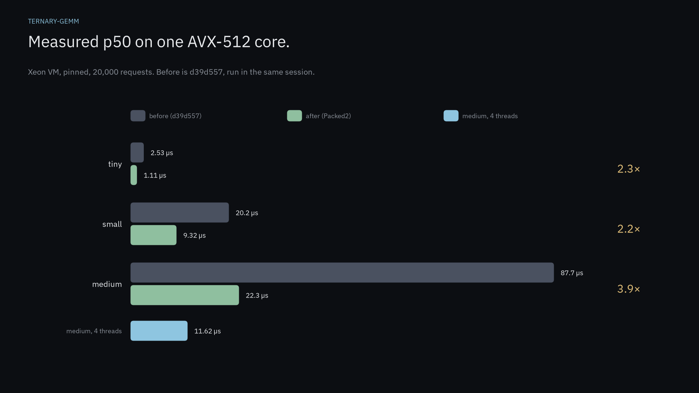

# CPU performance: Packed2 + spin pool

All numbers on this page were **measured** on the build machine: an 8-vCPU Intel Xeon cloud VM
(AVX-512 F/BW/VNNI/VBMI, 2 MiB L2 per core, 48 KiB L1d), `taskset -c 3`, `--cpu-only`,
20,000 timed requests per path after 2,000 warm-up. That is the same method as the earlier
README table. The "before" binary was built from `d39d557` (main before this change) and run
in the same session, interleaved with the "after" binary, so both sides saw the same machine
state. The p50 values are medians of two interleaved runs. No GPU numbers appear here.

A 38-second explainer of the layout, the spin-wait pool and these measured p50 figures ([video](media/cpu-speedup-explainer.mp4), [GIF](media/cpu-speedup-explainer.gif)):

[](media/cpu-speedup-explainer.mp4)

## What changed

1. **`Packed2` layout (`src/cpu_packed.rs`).** Rows are grouped in blocks of 16 and K in
   chunks of 256. A row's chunk is 64 bytes, and byte `j` holds the 2-bit codes of
   `k = j, j+64, j+128, j+192` in bit pairs 0-1, 2-3, 4-5 and 6-7. One 64-byte load per row
   per chunk therefore feeds four `vpdpbusd` steps.
2. **Decode with `vpmultishiftqb` (AVX-512 VBMI).** One instruction plus an AND turns 64 packed
   bytes into 64 code bytes for each of the four parts. The codes are unsigned {0,1,2}, so
   `vpdpbusd` (u8×s8) works with no sign handling, and the per-token `Σq` is subtracted in the
   epilogue as before.
3. **16 independent accumulators** per 16-row block, then a `reduce16` transpose-add tree that
   produces the 16 row sums in one vector.
4. **Vectorized epilogue** (AVX-512 and AVX2). It does `(acc − Σq) / s · scale`, then act,
   residual and fp16, with exactly the same rounding as the scalar code. `max_ps` operand order
   reproduces the scalar ReLU semantics for −0 and NaN, and a test covers those edge values.
5. **`SpinPool` (`src/spin_pool.rs`).** Persistent workers wait on an epoch counter (spin,
   then yield), so a parallel GEMV does not pay a thread spawn or futex wake per call (the
   handoff is a few cache-line writes). Work is split by 16-row block ranges, so the result is identical for any thread
   count. Below `PAR_MIN_WEIGHTS = 2^19` weights the engine stays single-threaded, because the
   handoff would cost more than it saves.
6. `CpuEngine` uses Packed2 only when AVX-512 VNNI+VBMI is present. On AVX2-only machines it
   keeps the byte-code kernel, because an AVX2 Packed2 variant exists and is tested but measured
   **slower** (tiny 2.75 vs 2.25 µs, small 31 vs 20 µs). `CpuTernary` (any batch) uses Packed2
   for single-threaded calls.

## Measured p50 latency (µs, lower is better)

`--features avx512` build (the README's headline configuration):

| model | before (d39d557) | after | speedup | earlier README value |
|---|---|---|---|---|
| tiny 64-256-256-1 | 2.53 | **1.11** | 2.3× | 2.28 |
| small 256-1024-1024-16 | 20.2 (15.9–24.5) | **9.32** | 2.2× | 18.30 |
| medium 1024×4 → 4 | 87.7 | **22.3** | 3.9× | 80.60 |

Against the earlier published README values, the gains are 2.05× (tiny), 1.96× (small) and
3.6× (medium).

Full tails for the after run (`results/20261122-195100-cpu-latency-avx512-packed2.json`):

| model | path | p50 | p99 | p99.9 | max |
|---|---|---|---|---|---|
| tiny | ternary SIMD (Packed2, AVX-512 VNNI+VBMI) | 1.12 | 1.43 | 2.38 | 12.4 |
| tiny | dense f32 SIMD | 5.13 | 6.21 | 11.03 | 31.3 |
| small | ternary SIMD (Packed2) | 9.33 | 12.52 | 21.36 | 46.5 |
| small | dense f32 SIMD | 159.13 | 216.61 | 246.55 | 455.6 |
| medium | ternary SIMD (Packed2) | 22.87 | 28.26 | 40.42 | 64.7 |
| medium | dense f32 SIMD | 450.81 | 674.35 | 1029.68 | 21691.5 |

The dense f32 baseline was not changed. Its p50 wanders between about 390 and 470 µs for
medium from run to run on this VM, in line with the earlier 471.50.

Threads (`latency --threads 4`, pinned to cores 2-5, `results/…-packed2-4threads.json`):

| model | 1 thread | 4 threads |
|---|---|---|
| tiny | 1.19 | 1.11 (below the threshold, so it runs single-threaded) |
| small | 10.36 | 6.21 |
| medium | 22.85 | 11.62 |

An 8-thread quick run gave medium ≈ 10.5 µs, so the gain flattens past 4 threads on this VM.

Default build (AVX2 only, no `avx512` feature):

| model | before | after | change |
|---|---|---|---|
| tiny | 2.48 | 1.90 | 1.3× (vectorized epilogue) |
| small | 23.2 | 18.0 | 1.3× |
| medium | 82.4 | 85.2 | no change (L3/bandwidth-bound) |

Looped transformer criterion bench (AVX-512, d256, t8): 272 / 1061 / 2169 µs → 196 / 762 /
1547 µs for 1 / 4 / 8 loops (about 1.4×).

## Why not 100×

At batch 1, ternary GEMV is bound by memory bandwidth. The weights are 2 bits each, against
16 bits for fp16, so the theoretical ceiling for ternary vs fp16 at batch 1 is **8×** in bytes
moved, and no kernel can beat the time it takes to read its weights. The 2–4× above comes from
cutting instruction count (decode is now 2 instructions per 64 weights) and per-call overhead
(the epilogue and thread handoff), not from moving fewer bytes. The medium model's weights
(about 0.8 MiB packed) fit in L2, which is why it gained the most.

## Reproduce

```bash
cargo build --release --features avx512 --bin latency
taskset -c 3 target/release/latency --cpu-only --json after.json
taskset -c 2-5 target/release/latency --cpu-only --skip-reference --threads 4
./scripts/bench.sh --cpu-threads 4       # adds the threaded row to the bench report
./scripts/bench.sh --byte-codes          # adds the old byte-code engine for comparison
```
