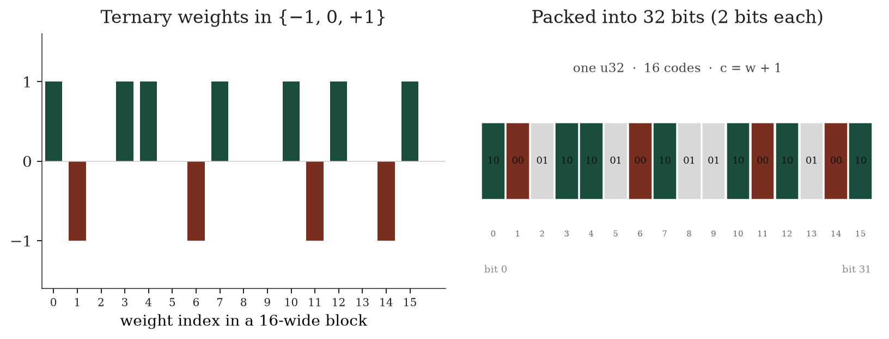
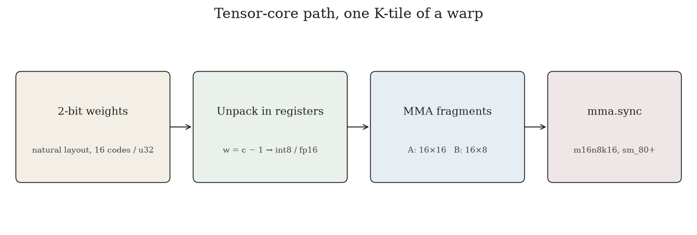
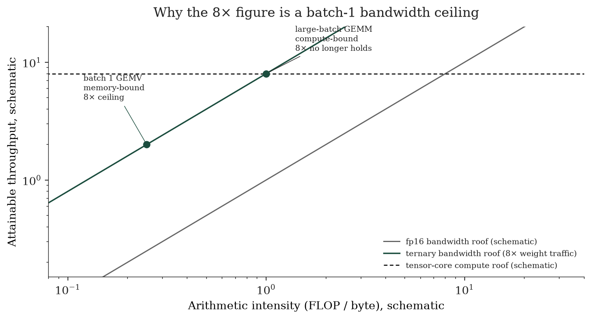
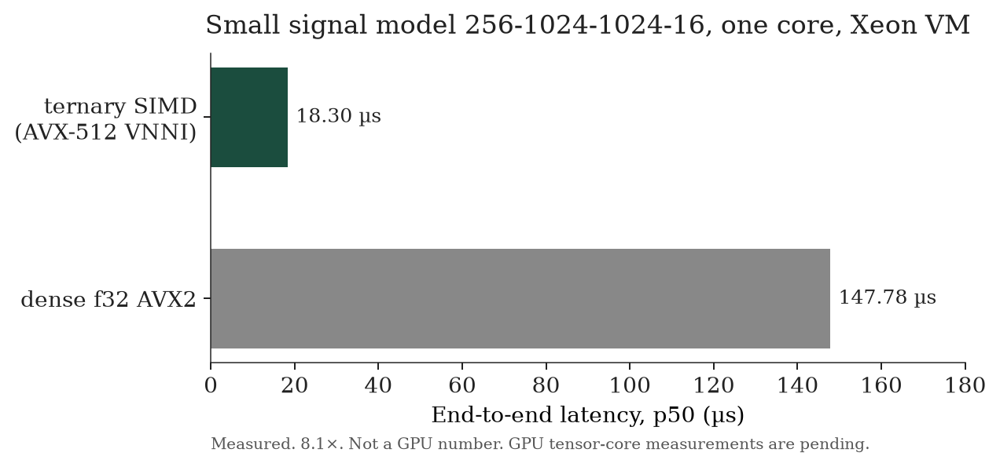

# A tensor-core path for ternary GEMM

Shubh Gupta  
22 November 2026

*ternary-gemm* is a Rust and CUDA library of fused kernels for models whose weights live in {−1, 0, +1}. This note describes a new backend that unpacks those 2-bit weights into int8 or fp16 fragments and issues NVIDIA `mma.sync` tensor-core instructions, in the style of TriRun and BitBLAS. The only measured numbers in this report are CPU latencies. The 8× figure versus fp16 at batch 1 is a theoretical bandwidth ceiling, not a GPU result. GPU measurements are pending.

## 1. Motivation

The cost of inference is increasingly a cost in energy and in latency per token, not a cost in training FLOPs. For a decode step the working set is a sequence of matrix–vector products: each output row of a linear layer reads its weights once, multiplies them by a single activation vector, and writes a single output. When the weights are stored in fp16, that traffic is two bytes per element. When they are ternary and packed in two bits, it is a quarter of a byte — eight times less.

That ratio matters only if the kernel can actually feed the arithmetic units from those packed bits, and only if the problem is memory-bound. The existing kernels in this repository do the first part with `dp4a` on integer ALUs. Tensor cores are the units that later GPUs provision for dense GEMM, and the natural next step is to unpack the same 2-bit payload into the fragments those units expect. The prize, if the path is bandwidth-bound, is more tokens per joule and fewer microseconds per token. Whether that prize is collected on a given GPU is a measurement, and that measurement has not been made here.

## 2. Ternary packing

Every weight is an element of {−1, 0, +1}. The library stores it as the code *c* = *w* + 1 in {0, 1, 2}, sixteen codes to a 32-bit word. In the *natural* layout, weight *k* of a row lives in word ⌊*k*/16⌋ at bits 2(*k* mod 16). Figure 1 shows one such 16-wide block and the word it becomes.



**Figure 1.** A 16-wide block of ternary weights and its packed representation. Each 2-bit field is the code *c* = *w* + 1. Weight 0 occupies bits 0–1.

A second, *permuted* layout, used by the `dp4a` kernels, rearranges those codes so that a shift-and-mask produces four consecutive weights as bytes, ready for `__dp4a`. Both layouts are stored on the device. The tensor-core path unpacks from the natural layout, which maps directly onto the K dimension of an `m16n8k16` tile.

Activation quantization on the W2A8 path is unchanged: BitNet’s per-token absmax scheme, *s* = 127 / max(|*x*|, 10⁻⁵), with integer accumulation and the epilogue *y* = (Σ *w q*) / *s* · *w_scale*. Because the tensor-core kernel decodes weights to {−1, 0, +1} before the MMA, it does not need the (*c* − 1) correction that the `dp4a` kernels apply through a stored activation sum.

## 3. The tensor-core path

The new kernels live in `kernels/tensor_core.cu`. They are self-contained — no `#include` — so they can be compiled at runtime with NVRTC, the same way as the rest of the crate, for virtual architectures compute_80, compute_89 and compute_120 (and whatever sm_80+ device the driver presents). The instructions are PTX `mma.sync`, not WMMA, and they require sm_80 or newer.

Each warp owns a 16-row output tile, which is the M dimension of `m16n8k16`. Batch is tiled by 8, the N dimension. K is reduced in steps of 16. On every K-tile the block stages a 16-wide slice of activations in shared memory; each lane unpacks one natural word per owned row into an A fragment in registers; the matching activation nibble is packed into a B fragment; and the warp issues

- W2A8: `mma.sync.aligned.m16n8k16.row.col.s32.s8.s8.s32`
- W2A16: `mma.sync.aligned.m16n8k16.row.col.f32.f16.f16.f32`

The epilogue is the same as the CPU reference. *N* need not be a multiple of 16: out-of-range rows are padded with zero weights and are not written. *K* must still be a multiple of 64, and batch is 1 through 16 per launch, as elsewhere in the crate. Figure 2 summarises one K-tile.



**Figure 2.** One K-tile of a warp on the tensor-core path.

The backend is selectable. `Launch::backend` defaults to the existing `dp4a` family, so current callers are unchanged. `Launch::tensor_core(warps)` selects the new kernels. `Gpu::supports_tensor_cores()` is true only when the device is sm_80+ and the MMA kernels compiled and loaded. The fused `quantize`+GEMM launch remains `dp4a`-only; the tensor-core path is split (`quantize` then `gemm_i8`). The runtime autotuner adds tensor-core candidates — 1, 2, 4 and 8 warps per block — whenever the device supports them, times them against the `dp4a` search space, and records the winner with a `backend` column in its CSV cache.

A CPU reference in `src/tensor_core.rs` performs the same unpack, packs and unpacks the m16n8k16 fragments, and accumulates a tiled GEMM. Against the scalar oracle, the int8 path is bit-exact. That test runs without a GPU. The corresponding device tests in `tests/gpu.rs` are skipped when no CUDA device, or no sm_80+, is present.

## 4. Roofline analysis

At batch 1 the operation is a GEMV. Compulsory traffic is dominated by the weight matrix: 2*NK* bytes in fp16, *NK*/4 bytes in 2-bit ternary, a ratio of exactly eight. Activations, outputs and per-row scales shrink the net ratio slightly below eight, but not by much on the shapes that appear in a 2B-class model. If the kernel is memory-bound on those weights, eight is the ceiling on speedup versus a similarly memory-bound fp16 GEMV.

That ceiling is a statement about bytes, not a measurement of a kernel. Two things keep a real speedup below it. First, a GEMV whose ideal time is a few microseconds sits close to kernel-launch overhead, which graphs and fusion can amortise but not remove entirely. Second, as the batch grows, arithmetic intensity rises — FLOPs grow with batch, while the weight traffic does not — and the kernel eventually hits a compute roof. On a GPU whose dense GEMM runs on tensor cores, that roof is high, and a well-tuned fp16 tensor-core GEMM can catch up. The 8× figure is specifically the batch-1, weight-bandwidth case. Figure 3 draws this schematically. The axes are qualitative; no peak FLOP/s or DRAM bandwidth in the figure is a measurement from this work.



**Figure 3.** Schematic roofline. The ternary memory roof is eight times the fp16 memory roof because weight traffic is eight times smaller. A schematic tensor-core compute roof is drawn above both. At batch 1 the GEMV sits on the memory roof, where the 8× ceiling applies. At large batch the kernel is compute-bound and the 8× figure no longer holds. This is a diagram, not a measured roofline.

TriRun and BitBLAS are the prior art that reached near this ceiling on GEMV. Their numbers are theirs, not ours.

## 5. Measured CPU results

The only end-to-end latencies measured for this repository were taken on the CPU of the build machine: an 8-vCPU Intel Xeon cloud VM, one core pinned, 50,000 timed requests after 5,000 warm-up, on synthetic features and random untrained models. For the small signal model 256-1024-1024-16, the ternary SIMD engine (AVX-512 VNNI) ran in 18.30 µs at p50, against 147.78 µs for a dense f32 AVX2 baseline, a ratio of 8.1×. Figure 4 plots those two bars. The full tables, including other model sizes and tail percentiles, are in the project README and in `results/20261122-162423-cpu-latency-avx512.json`.



**Figure 4.** Measured CPU latency, p50, small signal model 256-1024-1024-16, one core, Xeon VM. This is not a GPU number. GPU tensor-core measurements are pending.

These numbers are included because they are real, and because they illustrate that a carefully packed ternary path can already show an 8×-class gain on one CPU core. They say nothing about the tensor-core kernels, which have not been timed on a GPU.

## 6. Prior art

The idea is not new. Microsoft’s BitNet GPU kernels and the BitNet papers describe a W2A8 GEMV that unpacks 2-bit weights into int8 and uses `dp4a`; they report 1.3–3.6× over BF16 on an A100. BitBLAS (Ladder, OSDI 2024) generates INT2×INT8 GEMV and GEMM and is a stronger baseline than has been run here. TriRun unpacks 2-bit (and related) payloads into tensor-core fragments and has published GEMV results near the bandwidth ceiling that Section 4 describes. Tritium is a Rust BitNet inference engine with CUDA kernels, including an IMMA path, and has published end-to-end tokens/s on an RTX 4090.

This repository is a smaller, NVRTC-compiled kernel library rather than a full inference engine. The tensor-core backend is a direct descendant of the TriRun / BitBLAS W2A8 style, wired into an existing dispatcher and autotuner, with a CPU fragment-level reference and a bit-exact int8 test. It has not been measured against any of those systems on the same GPU.

## 7. Pending: GPU measurements

No GPU latency, bandwidth, tokens/s, or energy figure for the tensor-core path — or for the `dp4a` path — has been measured in this repository. The kernels compile with NVRTC and assemble with `ptxas` for sm_80, sm_89 and sm_120, with no register spills on the tensor-core entries in those assemblies. That is a compile check, not a benchmark.

To fill this section in, run the following on a machine with an sm_80+ NVIDIA GPU, a recent driver, and the CUDA 12 runtime libraries `libnvrtc` and `libcublas`:

```bash
./scripts/bench.sh --tensor-cores
```

A shorter sweep (batches 1 and 16 only) is:

```bash
./scripts/bench.sh --quick --tensor-cores
```

The script builds the crate, runs the correctness suite with `TERNARY_REQUIRE_GPU=1`, times the `dp4a` and tensor-core backends with CUDA events, writes a Markdown report and a CSV under `results/`, and records autotune winners. Those artefacts, once produced on a named GPU, are what should be cited as results. Until then, treat every GPU speedup in conversation about this work as unmeasured.

## 8. Methodology and limitations

**Correctness.** The int8 tensor-core algorithm is checked on the CPU by unpacking the natural layout into the published m16n8k16 fragment mapping, performing a tiled GEMM, and comparing bits against the scalar reference (`tests/tensor_core.rs`). The same comparison is made on device in `tests/gpu.rs` when a GPU is present. The W2A16 path accumulates in fp32 after exact fp16 encoding of {−1, 0, +1}; it is compared to a higher-precision reference with a tolerance, because a tensor-core MMA and a scalar fp64 sum are not the same rounding.

**Compilation.** `kernels/tensor_core.cu` contains no `#include`, by design, so NVRTC does not need CUDA headers on disk. A full CUDA toolkit with `nvcc` is optional. The crate still builds with `--no-default-features` (CPU only).

**What this path does not do.** It does not fuse activation quantization into the same launch. It does not use implicit GEMM layouts beyond the natural 2-bit pack, nor a dedicated prefill kernel for large batch, nor `wgmma` on Hopper and newer. It does not claim a measured tokens/s or a measured joules/token. Scales are per row, not per group. Batch is at most 16 per launch.

**What “8×” means in this document.** It means *NK*/4 bytes versus 2*NK* bytes of weight traffic, i.e. the theoretical bandwidth ceiling of a batch-1 GEMV against fp16 weights. It does not mean that a kernel on a GPU was timed and found to be eight times faster than cuBLAS or than an fp16 tensor-core GEMM.

## References

1. Ma, S. et al. *The Era of 1-bit LLMs: All Large Language Models are in 1.58 Bits.* 2024.  
2. Wang, J. et al. *BitNet.cpp / BitNet GPU kernels.* Microsoft, [github.com/microsoft/BitNet](https://github.com/microsoft/BitNet).  
3. Wang, L. et al. *Ladder: Enabling Efficient Low-Precision Deep Learning Computing through Hardware-aware Tensor Transformation.* OSDI 2024. BitBLAS: [github.com/microsoft/BitBLAS](https://github.com/microsoft/BitBLAS).  
4. Nolano. *TriRun.* [github.com/NolanoOrg/TriRun](https://github.com/NolanoOrg/TriRun). See also Spectra / TriRun, arXiv:2506.23025.  
5. Quitetall. *Tritium.* [github.com/Quitetall/tritium](https://github.com/Quitetall/tritium).  
6. NVIDIA. *Parallel Thread Execution ISA: `mma.sync.aligned`.* PTX documentation, m16n8k16 on sm_80 and later, including sm_89 and sm_120.
