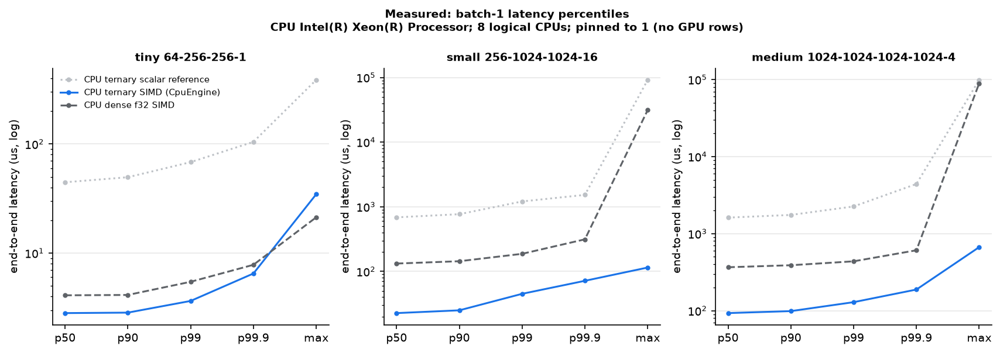
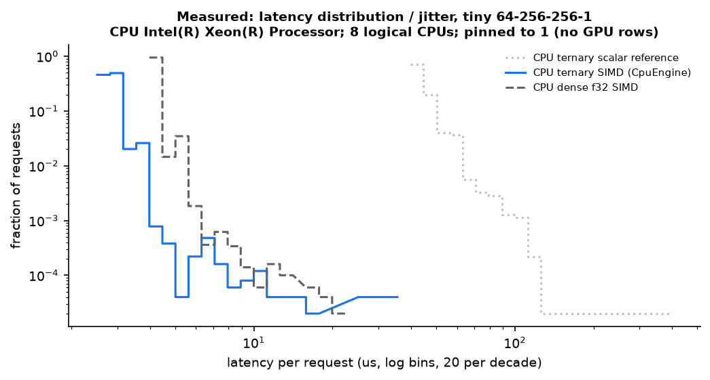
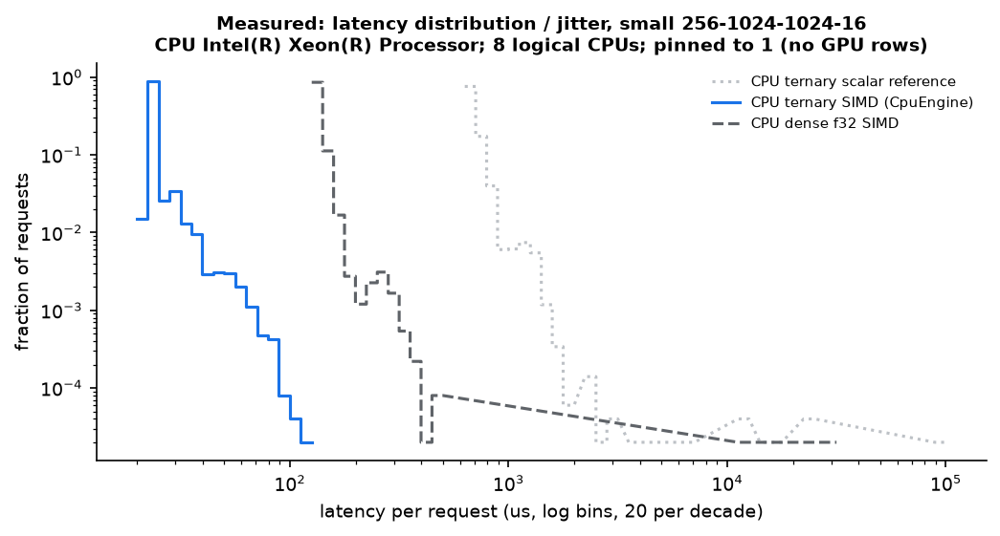
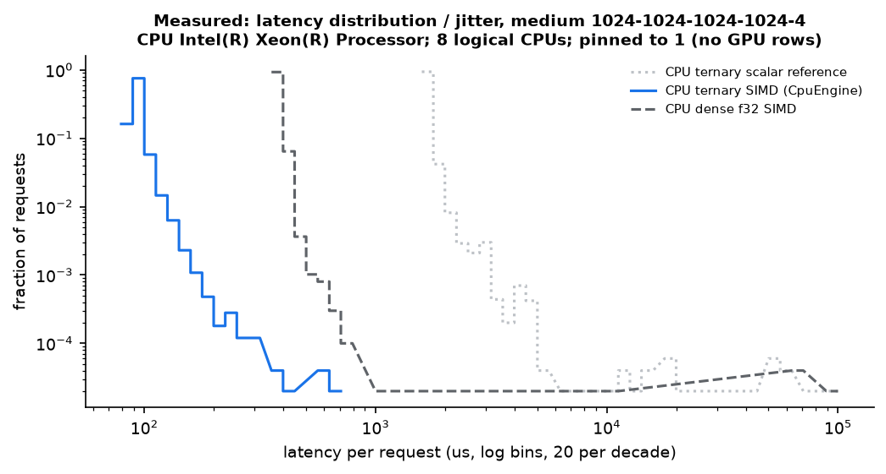

# Signal-model latency (batch 1, end to end, host -> signal -> host)

| | |
|---|---|
| CPU | Intel(R) Xeon(R) Processor; 8 logical CPUs; pinned to 1, SIMD path: avx2 |
| GPU | none found: GPU rows NOT MEASURED |
| Iterations | 50000 timed per path after 5000 warm-up, one request per iteration, timed with `Instant` |
| Inputs | SYNTHETIC random feature vectors, random untrained models: latency only, no trading claims |

Timer overhead (empty request, p50): 0.024 us

All latencies in microseconds.

| model | path | p50 | p90 | p99 | p99.9 | max | mean | std (jitter) |
|---|---|---|---|---|---|---|---|---|
| tiny 64-256-256-1 | CPU ternary scalar reference | 44.59 | 49.59 | 68.16 | 104.59 | 386.6 | 46.07 | 5.49 |
| tiny 64-256-256-1 | CPU ternary SIMD (CpuEngine) | 2.82 | 2.85 | 3.64 | 6.50 | 34.6 | 2.87 | 0.35 |
| tiny 64-256-256-1 | CPU dense f32 SIMD | 4.11 | 4.13 | 5.46 | 7.81 | 21.3 | 4.17 | 0.35 |
| small 256-1024-1024-16 | CPU ternary scalar reference | 685.38 | 767.08 | 1208.05 | 1525.53 | 91645.4 | 717.83 | 457.94 |
| small 256-1024-1024-16 | CPU ternary SIMD (CpuEngine) | 22.63 | 24.98 | 44.98 | 71.49 | 114.7 | 23.73 | 4.33 |
| small 256-1024-1024-16 | CPU dense f32 SIMD | 132.20 | 143.62 | 186.96 | 313.24 | 31291.5 | 137.89 | 150.63 |
| medium 1024-1024-1024-1024-4 | CPU ternary scalar reference | 1613.32 | 1747.58 | 2251.97 | 4407.46 | 98934.4 | 1673.84 | 829.73 |
| medium 1024-1024-1024-1024-4 | CPU ternary SIMD (CpuEngine) | 92.95 | 98.62 | 128.87 | 187.89 | 667.7 | 93.72 | 9.84 |
| medium 1024-1024-1024-1024-4 | CPU dense f32 SIMD | 365.91 | 388.60 | 436.94 | 607.71 | 89419.3 | 376.68 | 589.13 |

CSV -> results/20261122-025900-cpu-latency.csv

## Charts (measured)

