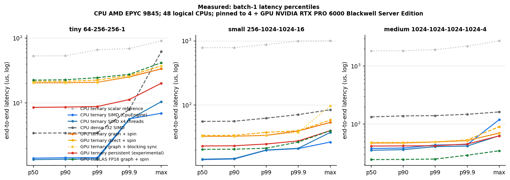
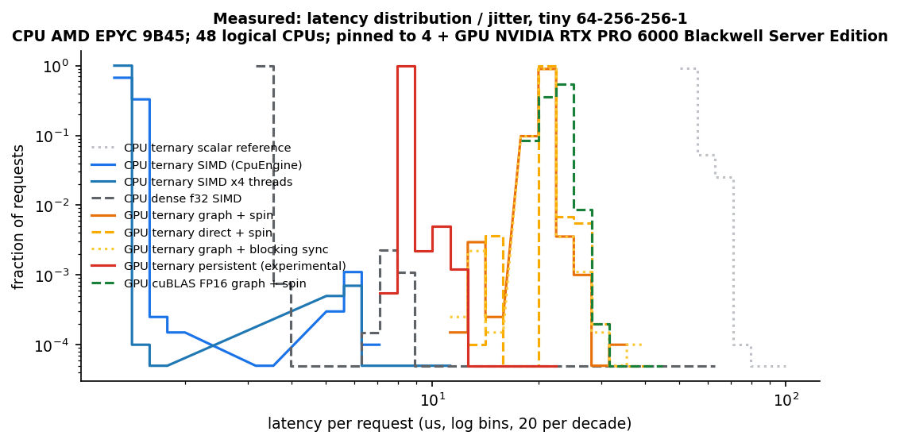
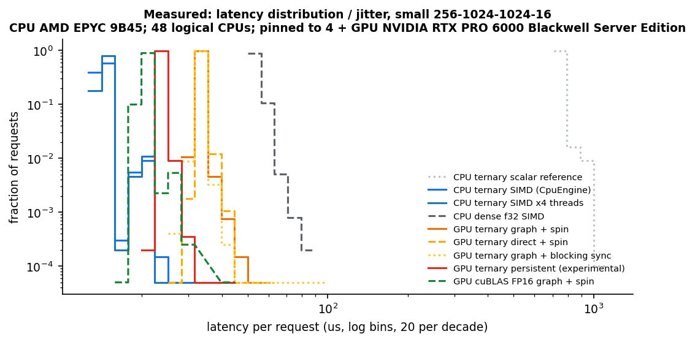
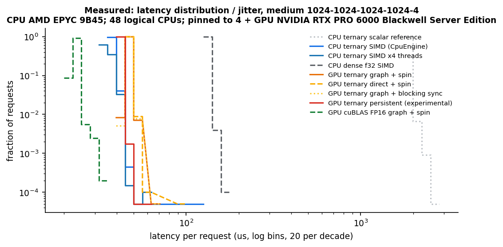

# Signal-model latency (batch 1, end to end, host -> signal -> host)

| | |
|---|---|
| CPU | AMD EPYC 9B45; 48 logical CPUs; pinned to 4, SIMD path: avx2 |
| GPU | NVIDIA RTX PRO 6000 Blackwell Server Edition (sm_120, 188 SMs) |
| Iterations | 20000 timed per path after 2000 warm-up, one request per iteration, timed with `Instant` |
| Inputs | SYNTHETIC random feature vectors, random untrained models: latency only, no trading claims |

Timer overhead (empty request, p50): 0.020 us

All latencies in microseconds.

| model | path | p50 | p90 | p99 | p99.9 | max | mean | std (jitter) |
|---|---|---|---|---|---|---|---|---|
| tiny 64-256-256-1 | CPU ternary scalar reference | 53.13 | 53.38 | 65.91 | 68.97 | 90.5 | 53.69 | 2.27 |
| tiny 64-256-256-1 | CPU ternary SIMD (CpuEngine) | 1.41 | 1.43 | 1.44 | 5.68 | 7.0 | 1.41 | 0.18 |
| tiny 64-256-256-1 | CPU ternary SIMD x4 threads | 1.34 | 1.36 | 1.37 | 5.58 | 10.5 | 1.34 | 0.18 |
| tiny 64-256-256-1 | CPU dense f32 SIMD | 3.43 | 3.45 | 3.47 | 7.97 | 61.9 | 3.45 | 0.49 |
| tiny 64-256-256-1 | GPU ternary graph + spin | 20.44 | 20.50 | 20.82 | 25.21 | 33.6 | 20.34 | 0.61 |
| tiny 64-256-256-1 | GPU ternary direct + spin | 21.46 | 21.55 | 22.53 | 26.61 | 37.1 | 21.39 | 0.67 |
| tiny 64-256-256-1 | GPU ternary graph + blocking sync | 20.44 | 20.50 | 20.83 | 25.56 | 37.1 | 20.35 | 0.60 |
| tiny 64-256-256-1 | GPU ternary persistent (experimental) | 8.55 | 8.65 | 8.82 | 11.28 | 20.2 | 8.58 | 0.22 |
| tiny 64-256-256-1 | GPU cuBLAS FP16 graph + spin | 22.47 | 22.77 | 24.52 | 27.61 | 41.7 | 22.24 | 1.07 |
| small 256-1024-1024-16 | CPU ternary scalar reference | 786.80 | 788.30 | 877.20 | 995.05 | 1001.9 | 788.20 | 17.20 |
| small 256-1024-1024-16 | CPU ternary SIMD (CpuEngine) | 14.20 | 14.53 | 19.89 | 21.08 | 26.6 | 14.27 | 0.78 |
| small 256-1024-1024-16 | CPU ternary SIMD x4 threads | 14.40 | 14.75 | 20.04 | 21.29 | 37.6 | 14.48 | 0.80 |
| small 256-1024-1024-16 | CPU dense f32 SIMD | 55.89 | 56.27 | 62.72 | 71.33 | 84.8 | 56.28 | 1.64 |
| small 256-1024-1024-16 | GPU ternary graph + spin | 32.73 | 32.80 | 33.91 | 39.66 | 53.9 | 32.69 | 0.59 |
| small 256-1024-1024-16 | GPU ternary direct + spin | 33.75 | 33.86 | 37.77 | 39.96 | 58.7 | 33.73 | 0.70 |
| small 256-1024-1024-16 | GPU ternary graph + blocking sync | 32.73 | 32.79 | 33.73 | 37.81 | 97.5 | 32.67 | 0.66 |
| small 256-1024-1024-16 | GPU ternary persistent (experimental) | 23.13 | 23.33 | 24.85 | 27.75 | 40.1 | 23.17 | 0.41 |
| small 256-1024-1024-16 | GPU cuBLAS FP16 graph + spin | 20.51 | 20.62 | 21.36 | 26.68 | 39.9 | 20.40 | 0.62 |
| medium 1024-1024-1024-1024-4 | CPU ternary scalar reference | 1844.50 | 1848.72 | 1930.99 | 2222.22 | 2734.2 | 1847.23 | 25.47 |
| medium 1024-1024-1024-1024-4 | CPU ternary SIMD (CpuEngine) | 37.93 | 38.55 | 43.50 | 44.40 | 119.4 | 38.20 | 1.24 |
| medium 1024-1024-1024-1024-4 | CPU ternary SIMD x4 threads | 35.32 | 36.20 | 40.78 | 41.82 | 63.0 | 35.62 | 1.12 |
| medium 1024-1024-1024-1024-4 | CPU dense f32 SIMD | 133.31 | 138.57 | 140.20 | 147.61 | 162.3 | 134.07 | 2.13 |
| medium 1024-1024-1024-1024-4 | GPU ternary graph + spin | 47.06 | 47.19 | 49.08 | 51.92 | 70.0 | 46.98 | 0.61 |
| medium 1024-1024-1024-1024-4 | GPU ternary direct + spin | 48.08 | 48.27 | 49.31 | 53.31 | 90.2 | 47.98 | 0.70 |
| medium 1024-1024-1024-1024-4 | GPU ternary graph + blocking sync | 47.06 | 47.17 | 49.28 | 52.21 | 68.5 | 47.02 | 0.60 |
| medium 1024-1024-1024-1024-4 | GPU ternary persistent (experimental) | 41.74 | 42.03 | 42.30 | 45.24 | 62.7 | 41.75 | 0.34 |
| medium 1024-1024-1024-1024-4 | GPU cuBLAS FP16 graph + spin | 24.36 | 24.55 | 24.91 | 29.02 | 34.6 | 23.63 | 1.11 |

## Energy (measured hardware counters: nvml)

| model | path | J / inference | inferences / J | avg W | wall s |
|---|---|---|---|---|---|
| tiny 64-256-256-1 | CPU ternary SIMD (CpuEngine) | 0.000e0 | inf | 0.0 | 0.03 |
| tiny 64-256-256-1 | CPU dense f32 SIMD | 5.496e-4 | 1820 | 160.3 | 0.07 |
| tiny 64-256-256-1 | GPU ternary graph + spin | 2.676e-3 | 374 | 131.3 | 0.41 |
| small 256-1024-1024-16 | CPU ternary SIMD (CpuEngine) | 1.265e-3 | 790 | 88.7 | 0.29 |
| small 256-1024-1024-16 | CPU dense f32 SIMD | 4.625e-3 | 216 | 82.3 | 1.12 |
| small 256-1024-1024-16 | GPU ternary graph + spin | 3.355e-3 | 298 | 102.6 | 0.65 |
| medium 1024-1024-1024-1024-4 | CPU ternary SIMD (CpuEngine) | 3.307e-3 | 302 | 86.9 | 0.76 |
| medium 1024-1024-1024-1024-4 | CPU dense f32 SIMD | 1.116e-2 | 90 | 83.2 | 2.68 |
| medium 1024-1024-1024-1024-4 | GPU ternary graph + spin | 4.414e-3 | 227 | 94.0 | 0.94 |

CSV -> results/20261123-020403-NVIDIA_RTX_PRO_6000_Blackwell_Server_Edition-latency.csv

## Charts (measured)

