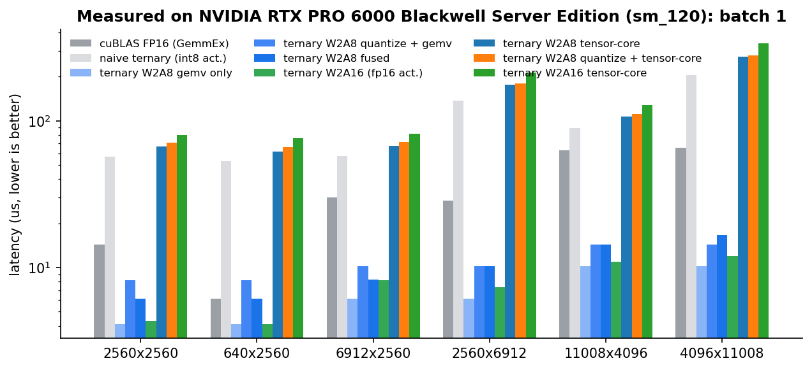
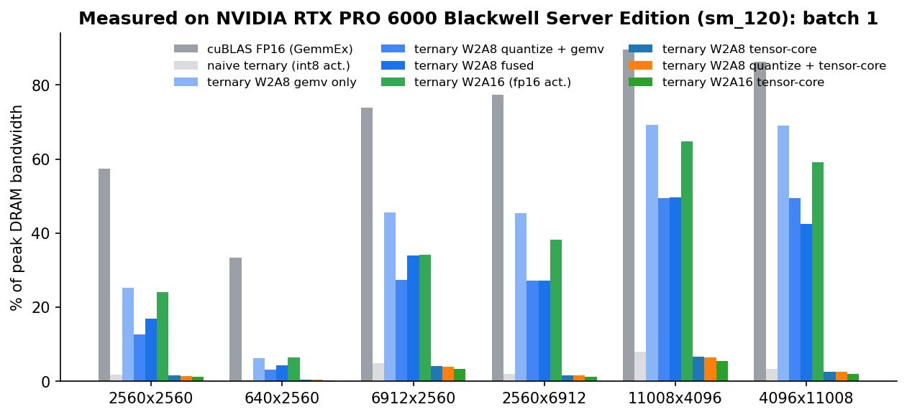
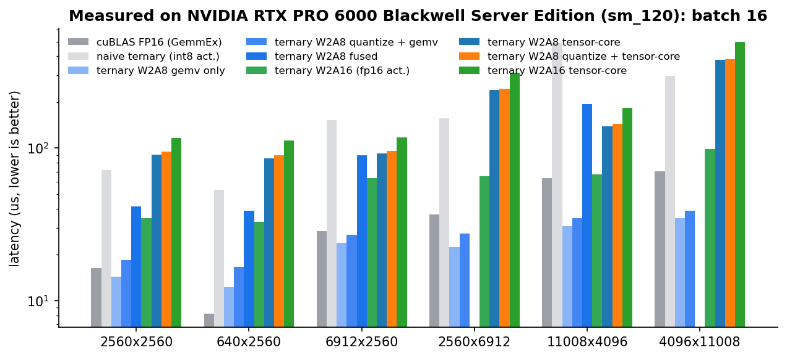
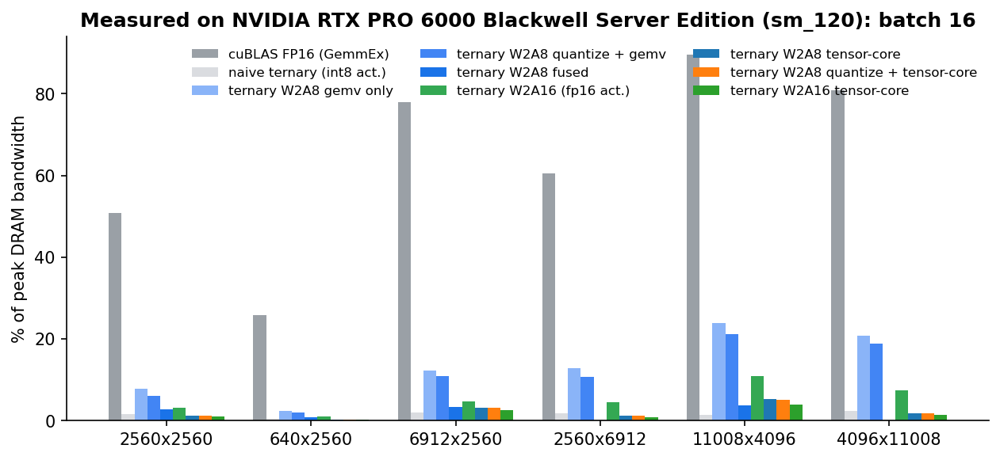
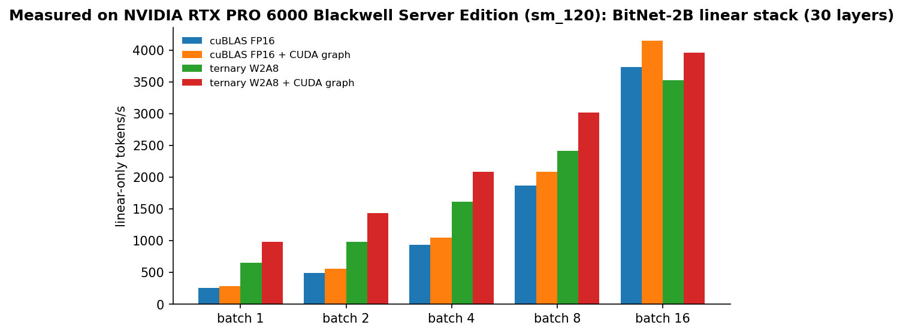

# ternary-gemm benchmark

| | |
|---|---|
| GPU | NVIDIA RTX PRO 6000 Blackwell Server Edition (sm_120, 188 SMs) |
| Memory | 95.0 GiB, L2 128 MiB |
| Peak DRAM BW used for % | 1597 GB/s (from PEAK_GBPS) |
| Kernels compiled for | compute_120 (NVRTC, driver-JIT to SASS) |
| Fused-kernel smem limit | batch x K <= 100352 B |
| Timing | CUDA events, median of 9 samples, weights rotated through >= 3x L2 so they stream from DRAM |

## Correctness vs CPU reference (run before timing)

| shape | batch | int8 (quantize + gemv) | int8 fused | fp16 act. | naive int8 | tensor-core i8 | tensor-core f16 |
|---|---|---|---|---|---|---|---|
| 2560 x 2560 | 1 | bit-exact | bit-exact | within tol (max abs err 1.94e-3, max |y| 6.60) | bit-exact | bit-exact | within tol |
| 2560 x 2560 | 16 | bit-exact | bit-exact | within tol (max abs err 3.48e-3, max |y| 8.64) | bit-exact | bit-exact | within tol |
| 640 x 2560 | 1 | bit-exact | bit-exact | within tol (max abs err 1.92e-3, max |y| 6.04) | bit-exact | bit-exact | within tol |
| 640 x 2560 | 16 | bit-exact | bit-exact | within tol (max abs err 1.95e-3, max |y| 7.66) | bit-exact | bit-exact | within tol |
| 6912 x 2560 | 1 | bit-exact | bit-exact | within tol (max abs err 1.93e-3, max |y| 7.45) | bit-exact | bit-exact | within tol |
| 6912 x 2560 | 16 | bit-exact | bit-exact | within tol (max abs err 3.81e-3, max |y| 8.98) | bit-exact | bit-exact | within tol |
| 2560 x 6912 | 1 | bit-exact | bit-exact | within tol (max abs err 3.46e-3, max |y| 11.71) | bit-exact | bit-exact | within tol |
| 2560 x 6912 | 16 | bit-exact | n/a (smem) | within tol (max abs err 3.89e-3, max |y| 13.26) | bit-exact | bit-exact | within tol |
| 11008 x 4096 | 1 | bit-exact | bit-exact | within tol (max abs err 3.89e-3, max |y| 9.16) | bit-exact | bit-exact | within tol |
| 11008 x 4096 | 16 | bit-exact | bit-exact | within tol (max abs err 3.91e-3, max |y| 12.93) | bit-exact | bit-exact | within tol |
| 4096 x 11008 | 1 | bit-exact | bit-exact | within tol (max abs err 3.89e-3, max |y| 15.34) | bit-exact | bit-exact | within tol |
| 4096 x 11008 | 16 | bit-exact | n/a (smem) | within tol (max abs err 4.25e-3, max |y| 19.61) | bit-exact | bit-exact | within tol |

## Per-shape kernel latency

`eff GB/s` = compulsory bytes (weights + scales + activations in + outputs) / latency. `vs cuBLAS` = cuBLAS FP16 latency / kernel latency.

| shape (N x K) | batch | kernel | latency (us) | eff GB/s | % of peak | vs cuBLAS | notes |
|---|---|---|---|---|---|---|---|
| 2560 x 2560 (BitNet-2B q/o) | 1 | cuBLAS FP16 (GemmEx) | 14.32 | 916 | 57% | 1.00x | dense fp16 weights |
| 2560 x 2560 (BitNet-2B q/o) | 1 | naive ternary (int8 act.) | 56.74 | 29 | 2% | 0.25x | 1 thread/output, pre-quantized acts |
| 2560 x 2560 (BitNet-2B q/o) | 1 | **ternary W2A8 gemv only** | 4.10 | 404 | 25% | 3.50x | pre-quantized acts, R=1 |
| 2560 x 2560 (BitNet-2B q/o) | 1 | **ternary W2A8 quantize + gemv** | 8.20 | 202 | 13% | 1.75x | 2 launches, fp16 in -> fp16 out, R=4 |
| 2560 x 2560 (BitNet-2B q/o) | 1 | **ternary W2A8 fused** | 6.15 | 270 | 17% | 2.33x | 1 launch, quant in prologue, R=2 |
| 2560 x 2560 (BitNet-2B q/o) | 1 | ternary W2A16 (fp16 act.) | 4.31 | 385 | 24% | 3.32x | R=1 |
| 2560 x 2560 (BitNet-2B q/o) | 1 | **ternary W2A8 tensor-core** | 66.81 | 25 | 2% | 0.21x | mma.sync m16n8k16 s8, pre-quantized acts, 4 warps |
| 2560 x 2560 (BitNet-2B q/o) | 1 | **ternary W2A8 quantize + tensor-core** | 70.90 | 23 | 1% | 0.20x | 2 launches, mma.sync, 4 warps |
| 2560 x 2560 (BitNet-2B q/o) | 1 | ternary W2A16 tensor-core | 80.03 | 21 | 1% | 0.18x | mma.sync m16n8k16 f16, 4 warps |
| 2560 x 2560 (BitNet-2B q/o) | 2 | cuBLAS FP16 (GemmEx) | 16.07 | 817 | 51% | 1.00x | dense fp16 weights |
| 2560 x 2560 (BitNet-2B q/o) | 2 | naive ternary (int8 act.) | 56.60 | 29 | 2% | 0.28x | 1 thread/output, pre-quantized acts |
| 2560 x 2560 (BitNet-2B q/o) | 2 | **ternary W2A8 gemv only** | 6.14 | 271 | 17% | 2.62x | pre-quantized acts, R=1 |
| 2560 x 2560 (BitNet-2B q/o) | 2 | **ternary W2A8 quantize + gemv** | 10.24 | 163 | 10% | 1.57x | 2 launches, fp16 in -> fp16 out, R=1 |
| 2560 x 2560 (BitNet-2B q/o) | 2 | **ternary W2A8 fused** | 8.26 | 202 | 13% | 1.94x | 1 launch, quant in prologue, R=2 |
| 2560 x 2560 (BitNet-2B q/o) | 2 | ternary W2A16 (fp16 act.) | 8.19 | 204 | 13% | 1.96x | R=1 |
| 2560 x 2560 (BitNet-2B q/o) | 2 | **ternary W2A8 tensor-core** | 67.16 | 25 | 2% | 0.24x | mma.sync m16n8k16 s8, pre-quantized acts, 4 warps |
| 2560 x 2560 (BitNet-2B q/o) | 2 | **ternary W2A8 quantize + tensor-core** | 71.24 | 23 | 1% | 0.23x | 2 launches, mma.sync, 4 warps |
| 2560 x 2560 (BitNet-2B q/o) | 2 | ternary W2A16 tensor-core | 80.16 | 21 | 1% | 0.20x | mma.sync m16n8k16 f16, 4 warps |
| 2560 x 2560 (BitNet-2B q/o) | 4 | cuBLAS FP16 (GemmEx) | 16.10 | 816 | 51% | 1.00x | dense fp16 weights |
| 2560 x 2560 (BitNet-2B q/o) | 4 | naive ternary (int8 act.) | 55.25 | 30 | 2% | 0.29x | 1 thread/output, pre-quantized acts |
| 2560 x 2560 (BitNet-2B q/o) | 4 | **ternary W2A8 gemv only** | 8.19 | 205 | 13% | 1.97x | pre-quantized acts, R=4 |
| 2560 x 2560 (BitNet-2B q/o) | 4 | **ternary W2A8 quantize + gemv** | 12.28 | 138 | 9% | 1.31x | 2 launches, fp16 in -> fp16 out, R=4 |
| 2560 x 2560 (BitNet-2B q/o) | 4 | **ternary W2A8 fused** | 14.23 | 119 | 7% | 1.13x | 1 launch, quant in prologue, R=2 |
| 2560 x 2560 (BitNet-2B q/o) | 4 | ternary W2A16 (fp16 act.) | 12.28 | 138 | 9% | 1.31x | R=1 |
| 2560 x 2560 (BitNet-2B q/o) | 4 | **ternary W2A8 tensor-core** | 67.33 | 25 | 2% | 0.24x | mma.sync m16n8k16 s8, pre-quantized acts, 4 warps |
| 2560 x 2560 (BitNet-2B q/o) | 4 | **ternary W2A8 quantize + tensor-core** | 71.30 | 24 | 1% | 0.23x | 2 launches, mma.sync, 4 warps |
| 2560 x 2560 (BitNet-2B q/o) | 4 | ternary W2A16 tensor-core | 80.79 | 21 | 1% | 0.20x | mma.sync m16n8k16 f16, 4 warps |
| 2560 x 2560 (BitNet-2B q/o) | 8 | cuBLAS FP16 (GemmEx) | 16.27 | 811 | 51% | 1.00x | dense fp16 weights |
| 2560 x 2560 (BitNet-2B q/o) | 8 | naive ternary (int8 act.) | 55.15 | 31 | 2% | 0.29x | 1 thread/output, pre-quantized acts |
| 2560 x 2560 (BitNet-2B q/o) | 8 | **ternary W2A8 gemv only** | 10.24 | 167 | 10% | 1.59x | pre-quantized acts, R=1 |
| 2560 x 2560 (BitNet-2B q/o) | 8 | **ternary W2A8 quantize + gemv** | 14.33 | 121 | 8% | 1.14x | 2 launches, fp16 in -> fp16 out, R=1 |
| 2560 x 2560 (BitNet-2B q/o) | 8 | **ternary W2A8 fused** | 22.54 | 77 | 5% | 0.72x | 1 launch, quant in prologue, R=2 |
| 2560 x 2560 (BitNet-2B q/o) | 8 | ternary W2A16 (fp16 act.) | 20.47 | 85 | 5% | 0.79x | R=1 |
| 2560 x 2560 (BitNet-2B q/o) | 8 | **ternary W2A8 tensor-core** | 67.89 | 25 | 2% | 0.24x | mma.sync m16n8k16 s8, pre-quantized acts, 4 warps |
| 2560 x 2560 (BitNet-2B q/o) | 8 | **ternary W2A8 quantize + tensor-core** | 71.91 | 24 | 2% | 0.23x | 2 launches, mma.sync, 4 warps |
| 2560 x 2560 (BitNet-2B q/o) | 8 | ternary W2A16 tensor-core | 81.50 | 21 | 1% | 0.20x | mma.sync m16n8k16 f16, 4 warps |
| 2560 x 2560 (BitNet-2B q/o) | 16 | cuBLAS FP16 (GemmEx) | 16.34 | 812 | 51% | 1.00x | dense fp16 weights |
| 2560 x 2560 (BitNet-2B q/o) | 16 | naive ternary (int8 act.) | 71.59 | 25 | 2% | 0.23x | 1 thread/output, pre-quantized acts |
| 2560 x 2560 (BitNet-2B q/o) | 16 | **ternary W2A8 gemv only** | 14.34 | 124 | 8% | 1.14x | pre-quantized acts, R=1 |
| 2560 x 2560 (BitNet-2B q/o) | 16 | **ternary W2A8 quantize + gemv** | 18.44 | 98 | 6% | 0.89x | 2 launches, fp16 in -> fp16 out, R=1 |
| 2560 x 2560 (BitNet-2B q/o) | 16 | **ternary W2A8 fused** | 41.32 | 44 | 3% | 0.40x | 1 launch, quant in prologue, R=2 |
| 2560 x 2560 (BitNet-2B q/o) | 16 | ternary W2A16 (fp16 act.) | 34.83 | 52 | 3% | 0.47x | R=1 |
| 2560 x 2560 (BitNet-2B q/o) | 16 | **ternary W2A8 tensor-core** | 90.98 | 19 | 1% | 0.18x | mma.sync m16n8k16 s8, pre-quantized acts, 4 warps |
| 2560 x 2560 (BitNet-2B q/o) | 16 | **ternary W2A8 quantize + tensor-core** | 95.07 | 19 | 1% | 0.17x | 2 launches, mma.sync, 4 warps |
| 2560 x 2560 (BitNet-2B q/o) | 16 | ternary W2A16 tensor-core | 116.49 | 16 | 1% | 0.14x | mma.sync m16n8k16 f16, 4 warps |
| 640 x 2560 (BitNet-2B k/v) | 1 | cuBLAS FP16 (GemmEx) | 6.15 | 534 | 33% | 1.00x | dense fp16 weights |
| 640 x 2560 (BitNet-2B k/v) | 1 | naive ternary (int8 act.) | 53.01 | 8 | 0% | 0.12x | 1 thread/output, pre-quantized acts |
| 640 x 2560 (BitNet-2B k/v) | 1 | **ternary W2A8 gemv only** | 4.09 | 102 | 6% | 1.50x | pre-quantized acts, R=1 |
| 640 x 2560 (BitNet-2B k/v) | 1 | **ternary W2A8 quantize + gemv** | 8.19 | 51 | 3% | 0.75x | 2 launches, fp16 in -> fp16 out, R=2 |
| 640 x 2560 (BitNet-2B k/v) | 1 | **ternary W2A8 fused** | 6.14 | 68 | 4% | 1.00x | 1 launch, quant in prologue, R=1 |
| 640 x 2560 (BitNet-2B k/v) | 1 | ternary W2A16 (fp16 act.) | 4.10 | 102 | 6% | 1.50x | R=1 |
| 640 x 2560 (BitNet-2B k/v) | 1 | **ternary W2A8 tensor-core** | 61.89 | 7 | 0% | 0.10x | mma.sync m16n8k16 s8, pre-quantized acts, 4 warps |
| 640 x 2560 (BitNet-2B k/v) | 1 | **ternary W2A8 quantize + tensor-core** | 65.97 | 6 | 0% | 0.09x | 2 launches, mma.sync, 4 warps |
| 640 x 2560 (BitNet-2B k/v) | 1 | ternary W2A16 tensor-core | 75.77 | 6 | 0% | 0.08x | mma.sync m16n8k16 f16, 4 warps |
| 640 x 2560 (BitNet-2B k/v) | 2 | cuBLAS FP16 (GemmEx) | 8.19 | 401 | 25% | 1.00x | dense fp16 weights |
| 640 x 2560 (BitNet-2B k/v) | 2 | naive ternary (int8 act.) | 53.24 | 8 | 0% | 0.15x | 1 thread/output, pre-quantized acts |
| 640 x 2560 (BitNet-2B k/v) | 2 | **ternary W2A8 gemv only** | 4.51 | 93 | 6% | 1.82x | pre-quantized acts, R=2 |
| 640 x 2560 (BitNet-2B k/v) | 2 | **ternary W2A8 quantize + gemv** | 8.20 | 52 | 3% | 1.00x | 2 launches, fp16 in -> fp16 out, R=2 |
| 640 x 2560 (BitNet-2B k/v) | 2 | **ternary W2A8 fused** | 8.19 | 52 | 3% | 1.00x | 1 launch, quant in prologue, R=1 |
| 640 x 2560 (BitNet-2B k/v) | 2 | ternary W2A16 (fp16 act.) | 8.19 | 52 | 3% | 1.00x | R=4 |
| 640 x 2560 (BitNet-2B k/v) | 2 | **ternary W2A8 tensor-core** | 63.35 | 7 | 0% | 0.13x | mma.sync m16n8k16 s8, pre-quantized acts, 4 warps |
| 640 x 2560 (BitNet-2B k/v) | 2 | **ternary W2A8 quantize + tensor-core** | 67.44 | 6 | 0% | 0.12x | 2 launches, mma.sync, 4 warps |
| 640 x 2560 (BitNet-2B k/v) | 2 | ternary W2A16 tensor-core | 75.79 | 6 | 0% | 0.11x | mma.sync m16n8k16 f16, 4 warps |
| 640 x 2560 (BitNet-2B k/v) | 4 | cuBLAS FP16 (GemmEx) | 8.20 | 403 | 25% | 1.00x | dense fp16 weights |
| 640 x 2560 (BitNet-2B k/v) | 4 | naive ternary (int8 act.) | 53.29 | 8 | 1% | 0.15x | 1 thread/output, pre-quantized acts |
| 640 x 2560 (BitNet-2B k/v) | 4 | **ternary W2A8 gemv only** | 6.15 | 70 | 4% | 1.33x | pre-quantized acts, R=4 |
| 640 x 2560 (BitNet-2B k/v) | 4 | **ternary W2A8 quantize + gemv** | 10.24 | 43 | 3% | 0.80x | 2 launches, fp16 in -> fp16 out, R=4 |
| 640 x 2560 (BitNet-2B k/v) | 4 | **ternary W2A8 fused** | 12.28 | 36 | 2% | 0.67x | 1 launch, quant in prologue, R=2 |
| 640 x 2560 (BitNet-2B k/v) | 4 | ternary W2A16 (fp16 act.) | 10.25 | 43 | 3% | 0.80x | R=1 |
| 640 x 2560 (BitNet-2B k/v) | 4 | **ternary W2A8 tensor-core** | 63.46 | 7 | 0% | 0.13x | mma.sync m16n8k16 s8, pre-quantized acts, 4 warps |
| 640 x 2560 (BitNet-2B k/v) | 4 | **ternary W2A8 quantize + tensor-core** | 67.55 | 6 | 0% | 0.12x | 2 launches, mma.sync, 4 warps |
| 640 x 2560 (BitNet-2B k/v) | 4 | ternary W2A16 tensor-core | 76.21 | 6 | 0% | 0.11x | mma.sync m16n8k16 f16, 4 warps |
| 640 x 2560 (BitNet-2B k/v) | 8 | cuBLAS FP16 (GemmEx) | 8.19 | 406 | 25% | 1.00x | dense fp16 weights |
| 640 x 2560 (BitNet-2B k/v) | 8 | naive ternary (int8 act.) | 53.29 | 8 | 1% | 0.15x | 1 thread/output, pre-quantized acts |
| 640 x 2560 (BitNet-2B k/v) | 8 | **ternary W2A8 gemv only** | 10.23 | 43 | 3% | 0.80x | pre-quantized acts, R=1 |
| 640 x 2560 (BitNet-2B k/v) | 8 | **ternary W2A8 quantize + gemv** | 13.52 | 34 | 2% | 0.61x | 2 launches, fp16 in -> fp16 out, R=1 |
| 640 x 2560 (BitNet-2B k/v) | 8 | **ternary W2A8 fused** | 20.49 | 23 | 1% | 0.40x | 1 launch, quant in prologue, R=1 |
| 640 x 2560 (BitNet-2B k/v) | 8 | ternary W2A16 (fp16 act.) | 18.42 | 25 | 2% | 0.44x | R=1 |
| 640 x 2560 (BitNet-2B k/v) | 8 | **ternary W2A8 tensor-core** | 63.47 | 7 | 0% | 0.13x | mma.sync m16n8k16 s8, pre-quantized acts, 4 warps |
| 640 x 2560 (BitNet-2B k/v) | 8 | **ternary W2A8 quantize + tensor-core** | 67.56 | 7 | 0% | 0.12x | 2 launches, mma.sync, 4 warps |
| 640 x 2560 (BitNet-2B k/v) | 8 | ternary W2A16 tensor-core | 77.79 | 6 | 0% | 0.11x | mma.sync m16n8k16 f16, 4 warps |
| 640 x 2560 (BitNet-2B k/v) | 16 | cuBLAS FP16 (GemmEx) | 8.20 | 412 | 26% | 1.00x | dense fp16 weights |
| 640 x 2560 (BitNet-2B k/v) | 16 | naive ternary (int8 act.) | 53.32 | 9 | 1% | 0.15x | 1 thread/output, pre-quantized acts |
| 640 x 2560 (BitNet-2B k/v) | 16 | **ternary W2A8 gemv only** | 12.29 | 39 | 2% | 0.67x | pre-quantized acts, R=1 |
| 640 x 2560 (BitNet-2B k/v) | 16 | **ternary W2A8 quantize + gemv** | 16.63 | 31 | 2% | 0.49x | 2 launches, fp16 in -> fp16 out, R=1 |
| 640 x 2560 (BitNet-2B k/v) | 16 | **ternary W2A8 fused** | 38.86 | 13 | 1% | 0.21x | 1 launch, quant in prologue, R=1 |
| 640 x 2560 (BitNet-2B k/v) | 16 | ternary W2A16 (fp16 act.) | 32.76 | 16 | 1% | 0.25x | R=1 |
| 640 x 2560 (BitNet-2B k/v) | 16 | **ternary W2A8 tensor-core** | 86.10 | 6 | 0% | 0.10x | mma.sync m16n8k16 s8, pre-quantized acts, 4 warps |
| 640 x 2560 (BitNet-2B k/v) | 16 | **ternary W2A8 quantize + tensor-core** | 90.18 | 6 | 0% | 0.09x | 2 launches, mma.sync, 4 warps |
| 640 x 2560 (BitNet-2B k/v) | 16 | ternary W2A16 tensor-core | 112.61 | 5 | 0% | 0.07x | mma.sync m16n8k16 f16, 4 warps |
| 6912 x 2560 (BitNet-2B gate/up) | 1 | cuBLAS FP16 (GemmEx) | 30.05 | 1178 | 74% | 1.00x | dense fp16 weights |
| 6912 x 2560 (BitNet-2B gate/up) | 1 | naive ternary (int8 act.) | 57.69 | 77 | 5% | 0.52x | 1 thread/output, pre-quantized acts |
| 6912 x 2560 (BitNet-2B gate/up) | 1 | **ternary W2A8 gemv only** | 6.15 | 727 | 46% | 4.89x | pre-quantized acts, R=1 |
| 6912 x 2560 (BitNet-2B gate/up) | 1 | **ternary W2A8 quantize + gemv** | 10.24 | 437 | 27% | 2.94x | 2 launches, fp16 in -> fp16 out, R=2 |
| 6912 x 2560 (BitNet-2B gate/up) | 1 | **ternary W2A8 fused** | 8.24 | 542 | 34% | 3.65x | 1 launch, quant in prologue, R=2 |
| 6912 x 2560 (BitNet-2B gate/up) | 1 | ternary W2A16 (fp16 act.) | 8.19 | 546 | 34% | 3.67x | R=1 |
| 6912 x 2560 (BitNet-2B gate/up) | 1 | **ternary W2A8 tensor-core** | 67.71 | 66 | 4% | 0.44x | mma.sync m16n8k16 s8, pre-quantized acts, 4 warps |
| 6912 x 2560 (BitNet-2B gate/up) | 1 | **ternary W2A8 quantize + tensor-core** | 71.77 | 62 | 4% | 0.42x | 2 launches, mma.sync, 4 warps |
| 6912 x 2560 (BitNet-2B gate/up) | 1 | ternary W2A16 tensor-core | 81.71 | 55 | 3% | 0.37x | mma.sync m16n8k16 f16, 4 warps |
| 6912 x 2560 (BitNet-2B gate/up) | 2 | cuBLAS FP16 (GemmEx) | 28.64 | 1237 | 77% | 1.00x | dense fp16 weights |
| 6912 x 2560 (BitNet-2B gate/up) | 2 | naive ternary (int8 act.) | 57.38 | 78 | 5% | 0.50x | 1 thread/output, pre-quantized acts |
| 6912 x 2560 (BitNet-2B gate/up) | 2 | **ternary W2A8 gemv only** | 7.41 | 605 | 38% | 3.87x | pre-quantized acts, R=1 |
| 6912 x 2560 (BitNet-2B gate/up) | 2 | **ternary W2A8 quantize + gemv** | 12.06 | 372 | 23% | 2.38x | 2 launches, fp16 in -> fp16 out, R=1 |
| 6912 x 2560 (BitNet-2B gate/up) | 2 | **ternary W2A8 fused** | 12.28 | 366 | 23% | 2.33x | 1 launch, quant in prologue, R=2 |
| 6912 x 2560 (BitNet-2B gate/up) | 2 | ternary W2A16 (fp16 act.) | 10.24 | 438 | 27% | 2.80x | R=2 |
| 6912 x 2560 (BitNet-2B gate/up) | 2 | **ternary W2A8 tensor-core** | 69.01 | 65 | 4% | 0.42x | mma.sync m16n8k16 s8, pre-quantized acts, 4 warps |
| 6912 x 2560 (BitNet-2B gate/up) | 2 | **ternary W2A8 quantize + tensor-core** | 72.92 | 62 | 4% | 0.39x | 2 launches, mma.sync, 4 warps |
| 6912 x 2560 (BitNet-2B gate/up) | 2 | ternary W2A16 tensor-core | 81.88 | 55 | 3% | 0.35x | mma.sync m16n8k16 f16, 4 warps |
| 6912 x 2560 (BitNet-2B gate/up) | 4 | cuBLAS FP16 (GemmEx) | 28.63 | 1239 | 78% | 1.00x | dense fp16 weights |
| 6912 x 2560 (BitNet-2B gate/up) | 4 | naive ternary (int8 act.) | 71.40 | 63 | 4% | 0.40x | 1 thread/output, pre-quantized acts |
| 6912 x 2560 (BitNet-2B gate/up) | 4 | **ternary W2A8 gemv only** | 10.24 | 441 | 28% | 2.80x | pre-quantized acts, R=1 |
| 6912 x 2560 (BitNet-2B gate/up) | 4 | **ternary W2A8 quantize + gemv** | 14.33 | 316 | 20% | 2.00x | 2 launches, fp16 in -> fp16 out, R=1 |
| 6912 x 2560 (BitNet-2B gate/up) | 4 | **ternary W2A8 fused** | 16.38 | 276 | 17% | 1.75x | 1 launch, quant in prologue, R=2 |
| 6912 x 2560 (BitNet-2B gate/up) | 4 | ternary W2A16 (fp16 act.) | 14.34 | 316 | 20% | 2.00x | R=2 |
| 6912 x 2560 (BitNet-2B gate/up) | 4 | **ternary W2A8 tensor-core** | 69.06 | 65 | 4% | 0.41x | mma.sync m16n8k16 s8, pre-quantized acts, 4 warps |
| 6912 x 2560 (BitNet-2B gate/up) | 4 | **ternary W2A8 quantize + tensor-core** | 72.99 | 62 | 4% | 0.39x | 2 launches, mma.sync, 4 warps |
| 6912 x 2560 (BitNet-2B gate/up) | 4 | ternary W2A16 tensor-core | 81.95 | 55 | 3% | 0.35x | mma.sync m16n8k16 f16, 4 warps |
| 6912 x 2560 (BitNet-2B gate/up) | 8 | cuBLAS FP16 (GemmEx) | 28.64 | 1241 | 78% | 1.00x | dense fp16 weights |
| 6912 x 2560 (BitNet-2B gate/up) | 8 | naive ternary (int8 act.) | 97.79 | 47 | 3% | 0.29x | 1 thread/output, pre-quantized acts |
| 6912 x 2560 (BitNet-2B gate/up) | 8 | **ternary W2A8 gemv only** | 14.33 | 320 | 20% | 2.00x | pre-quantized acts, R=1 |
| 6912 x 2560 (BitNet-2B gate/up) | 8 | **ternary W2A8 quantize + gemv** | 18.43 | 250 | 16% | 1.55x | 2 launches, fp16 in -> fp16 out, R=1 |
| 6912 x 2560 (BitNet-2B gate/up) | 8 | **ternary W2A8 fused** | 27.64 | 167 | 10% | 1.04x | 1 launch, quant in prologue, R=4 |
| 6912 x 2560 (BitNet-2B gate/up) | 8 | ternary W2A16 (fp16 act.) | 22.55 | 204 | 13% | 1.27x | R=2 |
| 6912 x 2560 (BitNet-2B gate/up) | 8 | **ternary W2A8 tensor-core** | 69.54 | 66 | 4% | 0.41x | mma.sync m16n8k16 s8, pre-quantized acts, 4 warps |
| 6912 x 2560 (BitNet-2B gate/up) | 8 | **ternary W2A8 quantize + tensor-core** | 73.63 | 63 | 4% | 0.39x | 2 launches, mma.sync, 4 warps |
| 6912 x 2560 (BitNet-2B gate/up) | 8 | ternary W2A16 tensor-core | 82.38 | 56 | 3% | 0.35x | mma.sync m16n8k16 f16, 4 warps |
| 6912 x 2560 (BitNet-2B gate/up) | 16 | cuBLAS FP16 (GemmEx) | 28.65 | 1246 | 78% | 1.00x | dense fp16 weights |
| 6912 x 2560 (BitNet-2B gate/up) | 16 | naive ternary (int8 act.) | 152.50 | 31 | 2% | 0.19x | 1 thread/output, pre-quantized acts |
| 6912 x 2560 (BitNet-2B gate/up) | 16 | **ternary W2A8 gemv only** | 23.97 | 197 | 12% | 1.20x | pre-quantized acts, R=1 |
| 6912 x 2560 (BitNet-2B gate/up) | 16 | **ternary W2A8 quantize + gemv** | 27.16 | 175 | 11% | 1.05x | 2 launches, fp16 in -> fp16 out, R=1 |
| 6912 x 2560 (BitNet-2B gate/up) | 16 | **ternary W2A8 fused** | 90.10 | 53 | 3% | 0.32x | 1 launch, quant in prologue, R=4 |
| 6912 x 2560 (BitNet-2B gate/up) | 16 | ternary W2A16 (fp16 act.) | 63.86 | 74 | 5% | 0.45x | R=2 |
| 6912 x 2560 (BitNet-2B gate/up) | 16 | **ternary W2A8 tensor-core** | 92.25 | 51 | 3% | 0.31x | mma.sync m16n8k16 s8, pre-quantized acts, 4 warps |
| 6912 x 2560 (BitNet-2B gate/up) | 16 | **ternary W2A8 quantize + tensor-core** | 96.34 | 49 | 3% | 0.30x | 2 launches, mma.sync, 4 warps |
| 6912 x 2560 (BitNet-2B gate/up) | 16 | ternary W2A16 tensor-core | 118.18 | 40 | 3% | 0.24x | mma.sync m16n8k16 f16, 4 warps |
| 2560 x 6912 (BitNet-2B down) | 1 | cuBLAS FP16 (GemmEx) | 28.68 | 1235 | 77% | 1.00x | dense fp16 weights |
| 2560 x 6912 (BitNet-2B down) | 1 | naive ternary (int8 act.) | 136.50 | 33 | 2% | 0.21x | 1 thread/output, pre-quantized acts |
| 2560 x 6912 (BitNet-2B down) | 1 | **ternary W2A8 gemv only** | 6.14 | 724 | 45% | 4.67x | pre-quantized acts, R=1 |
| 2560 x 6912 (BitNet-2B down) | 1 | **ternary W2A8 quantize + gemv** | 10.24 | 435 | 27% | 2.80x | 2 launches, fp16 in -> fp16 out, R=1 |
| 2560 x 6912 (BitNet-2B down) | 1 | **ternary W2A8 fused** | 10.24 | 435 | 27% | 2.80x | 1 launch, quant in prologue, R=4 |
| 2560 x 6912 (BitNet-2B down) | 1 | ternary W2A16 (fp16 act.) | 7.31 | 609 | 38% | 3.92x | R=1 |
| 2560 x 6912 (BitNet-2B down) | 1 | **ternary W2A8 tensor-core** | 175.32 | 25 | 2% | 0.16x | mma.sync m16n8k16 s8, pre-quantized acts, 4 warps |
| 2560 x 6912 (BitNet-2B down) | 1 | **ternary W2A8 quantize + tensor-core** | 179.28 | 25 | 2% | 0.16x | 2 launches, mma.sync, 4 warps |
| 2560 x 6912 (BitNet-2B down) | 1 | ternary W2A16 tensor-core | 212.73 | 21 | 1% | 0.13x | mma.sync m16n8k16 f16, 4 warps |
| 2560 x 6912 (BitNet-2B down) | 2 | cuBLAS FP16 (GemmEx) | 28.78 | 1231 | 77% | 1.00x | dense fp16 weights |
| 2560 x 6912 (BitNet-2B down) | 2 | naive ternary (int8 act.) | 132.79 | 34 | 2% | 0.22x | 1 thread/output, pre-quantized acts |
| 2560 x 6912 (BitNet-2B down) | 2 | **ternary W2A8 gemv only** | 8.20 | 544 | 34% | 3.51x | pre-quantized acts, R=1 |
| 2560 x 6912 (BitNet-2B down) | 2 | **ternary W2A8 quantize + gemv** | 12.29 | 364 | 23% | 2.34x | 2 launches, fp16 in -> fp16 out, R=1 |
| 2560 x 6912 (BitNet-2B down) | 2 | **ternary W2A8 fused** | 14.44 | 310 | 19% | 1.99x | 1 launch, quant in prologue, R=2 |
| 2560 x 6912 (BitNet-2B down) | 2 | ternary W2A16 (fp16 act.) | 12.86 | 348 | 22% | 2.24x | R=1 |
| 2560 x 6912 (BitNet-2B down) | 2 | **ternary W2A8 tensor-core** | 176.19 | 25 | 2% | 0.16x | mma.sync m16n8k16 s8, pre-quantized acts, 4 warps |
| 2560 x 6912 (BitNet-2B down) | 2 | **ternary W2A8 quantize + tensor-core** | 180.25 | 25 | 2% | 0.16x | 2 launches, mma.sync, 4 warps |
| 2560 x 6912 (BitNet-2B down) | 2 | ternary W2A16 tensor-core | 214.18 | 21 | 1% | 0.13x | mma.sync m16n8k16 f16, 4 warps |
| 2560 x 6912 (BitNet-2B down) | 4 | cuBLAS FP16 (GemmEx) | 36.89 | 961 | 60% | 1.00x | dense fp16 weights |
| 2560 x 6912 (BitNet-2B down) | 4 | naive ternary (int8 act.) | 132.10 | 34 | 2% | 0.28x | 1 thread/output, pre-quantized acts |
| 2560 x 6912 (BitNet-2B down) | 4 | **ternary W2A8 gemv only** | 11.21 | 400 | 25% | 3.29x | pre-quantized acts, R=4 |
| 2560 x 6912 (BitNet-2B down) | 4 | **ternary W2A8 quantize + gemv** | 15.79 | 286 | 18% | 2.34x | 2 launches, fp16 in -> fp16 out, R=4 |
| 2560 x 6912 (BitNet-2B down) | 4 | **ternary W2A8 fused** | 22.54 | 200 | 13% | 1.64x | 1 launch, quant in prologue, R=2 |
| 2560 x 6912 (BitNet-2B down) | 4 | ternary W2A16 (fp16 act.) | 20.49 | 220 | 14% | 1.80x | R=1 |
| 2560 x 6912 (BitNet-2B down) | 4 | **ternary W2A8 tensor-core** | 176.48 | 25 | 2% | 0.21x | mma.sync m16n8k16 s8, pre-quantized acts, 4 warps |
| 2560 x 6912 (BitNet-2B down) | 4 | **ternary W2A8 quantize + tensor-core** | 180.67 | 25 | 2% | 0.20x | 2 launches, mma.sync, 4 warps |
| 2560 x 6912 (BitNet-2B down) | 4 | ternary W2A16 tensor-core | 215.06 | 21 | 1% | 0.17x | mma.sync m16n8k16 f16, 4 warps |
| 2560 x 6912 (BitNet-2B down) | 8 | cuBLAS FP16 (GemmEx) | 36.90 | 963 | 60% | 1.00x | dense fp16 weights |
| 2560 x 6912 (BitNet-2B down) | 8 | naive ternary (int8 act.) | 133.13 | 34 | 2% | 0.28x | 1 thread/output, pre-quantized acts |
| 2560 x 6912 (BitNet-2B down) | 8 | **ternary W2A8 gemv only** | 16.39 | 276 | 17% | 2.25x | pre-quantized acts, R=1 |
| 2560 x 6912 (BitNet-2B down) | 8 | **ternary W2A8 quantize + gemv** | 20.48 | 224 | 14% | 1.80x | 2 launches, fp16 in -> fp16 out, R=1 |
| 2560 x 6912 (BitNet-2B down) | 8 | **ternary W2A8 fused** | 39.23 | 117 | 7% | 0.94x | 1 launch, quant in prologue, R=4 |
| 2560 x 6912 (BitNet-2B down) | 8 | ternary W2A16 (fp16 act.) | 34.85 | 132 | 8% | 1.06x | R=1 |
| 2560 x 6912 (BitNet-2B down) | 8 | **ternary W2A8 tensor-core** | 176.98 | 26 | 2% | 0.21x | mma.sync m16n8k16 s8, pre-quantized acts, 4 warps |
| 2560 x 6912 (BitNet-2B down) | 8 | **ternary W2A8 quantize + tensor-core** | 181.17 | 25 | 2% | 0.20x | 2 launches, mma.sync, 4 warps |
| 2560 x 6912 (BitNet-2B down) | 8 | ternary W2A16 tensor-core | 217.38 | 21 | 1% | 0.17x | mma.sync m16n8k16 f16, 4 warps |
| 2560 x 6912 (BitNet-2B down) | 16 | cuBLAS FP16 (GemmEx) | 36.92 | 967 | 61% | 1.00x | dense fp16 weights |
| 2560 x 6912 (BitNet-2B down) | 16 | naive ternary (int8 act.) | 156.50 | 30 | 2% | 0.24x | 1 thread/output, pre-quantized acts |
| 2560 x 6912 (BitNet-2B down) | 16 | **ternary W2A8 gemv only** | 22.54 | 205 | 13% | 1.64x | pre-quantized acts, R=1 |
| 2560 x 6912 (BitNet-2B down) | 16 | **ternary W2A8 quantize + gemv** | 27.51 | 172 | 11% | 1.34x | 2 launches, fp16 in -> fp16 out, R=1 |
| 2560 x 6912 (BitNet-2B down) | 16 | ternary W2A16 (fp16 act.) | 65.54 | 72 | 5% | 0.56x | R=1 |
| 2560 x 6912 (BitNet-2B down) | 16 | **ternary W2A8 tensor-core** | 241.24 | 19 | 1% | 0.15x | mma.sync m16n8k16 s8, pre-quantized acts, 4 warps |
| 2560 x 6912 (BitNet-2B down) | 16 | **ternary W2A8 quantize + tensor-core** | 245.24 | 19 | 1% | 0.15x | 2 launches, mma.sync, 4 warps |
| 2560 x 6912 (BitNet-2B down) | 16 | ternary W2A16 tensor-core | 313.89 | 15 | 1% | 0.12x | mma.sync m16n8k16 f16, 4 warps |
| 11008 x 4096 (7B-class up) | 1 | cuBLAS FP16 (GemmEx) | 63.13 | 1429 | 89% | 1.00x | dense fp16 weights |
| 11008 x 4096 (7B-class up) | 1 | naive ternary (int8 act.) | 88.87 | 128 | 8% | 0.71x | 1 thread/output, pre-quantized acts |
| 11008 x 4096 (7B-class up) | 1 | **ternary W2A8 gemv only** | 10.25 | 1107 | 69% | 6.16x | pre-quantized acts, R=1 |
| 11008 x 4096 (7B-class up) | 1 | **ternary W2A8 quantize + gemv** | 14.34 | 791 | 50% | 4.40x | 2 launches, fp16 in -> fp16 out, R=1 |
| 11008 x 4096 (7B-class up) | 1 | **ternary W2A8 fused** | 14.33 | 792 | 50% | 4.41x | 1 launch, quant in prologue, R=4 |
| 11008 x 4096 (7B-class up) | 1 | ternary W2A16 (fp16 act.) | 10.96 | 1036 | 65% | 5.76x | R=2 |
| 11008 x 4096 (7B-class up) | 1 | **ternary W2A8 tensor-core** | 106.59 | 106 | 7% | 0.59x | mma.sync m16n8k16 s8, pre-quantized acts, 4 warps |
| 11008 x 4096 (7B-class up) | 1 | **ternary W2A8 quantize + tensor-core** | 110.71 | 102 | 6% | 0.57x | 2 launches, mma.sync, 4 warps |
| 11008 x 4096 (7B-class up) | 1 | ternary W2A16 tensor-core | 127.29 | 89 | 6% | 0.50x | mma.sync m16n8k16 f16, 4 warps |
| 11008 x 4096 (7B-class up) | 2 | cuBLAS FP16 (GemmEx) | 62.36 | 1447 | 91% | 1.00x | dense fp16 weights |
| 11008 x 4096 (7B-class up) | 2 | naive ternary (int8 act.) | 85.86 | 132 | 8% | 0.73x | 1 thread/output, pre-quantized acts |
| 11008 x 4096 (7B-class up) | 2 | **ternary W2A8 gemv only** | 11.61 | 979 | 61% | 5.37x | pre-quantized acts, R=1 |
| 11008 x 4096 (7B-class up) | 2 | **ternary W2A8 quantize + gemv** | 15.53 | 733 | 46% | 4.02x | 2 launches, fp16 in -> fp16 out, R=1 |
| 11008 x 4096 (7B-class up) | 2 | **ternary W2A8 fused** | 16.39 | 694 | 43% | 3.80x | 1 launch, quant in prologue, R=4 |
| 11008 x 4096 (7B-class up) | 2 | ternary W2A16 (fp16 act.) | 14.33 | 794 | 50% | 4.35x | R=2 |
| 11008 x 4096 (7B-class up) | 2 | **ternary W2A8 tensor-core** | 105.17 | 108 | 7% | 0.59x | mma.sync m16n8k16 s8, pre-quantized acts, 4 warps |
| 11008 x 4096 (7B-class up) | 2 | **ternary W2A8 quantize + tensor-core** | 111.33 | 102 | 6% | 0.56x | 2 launches, mma.sync, 4 warps |
| 11008 x 4096 (7B-class up) | 2 | ternary W2A16 tensor-core | 128.90 | 88 | 6% | 0.48x | mma.sync m16n8k16 f16, 4 warps |
| 11008 x 4096 (7B-class up) | 4 | cuBLAS FP16 (GemmEx) | 62.17 | 1452 | 91% | 1.00x | dense fp16 weights |
| 11008 x 4096 (7B-class up) | 4 | naive ternary (int8 act.) | 98.63 | 116 | 7% | 0.63x | 1 thread/output, pre-quantized acts |
| 11008 x 4096 (7B-class up) | 4 | **ternary W2A8 gemv only** | 13.03 | 877 | 55% | 4.77x | pre-quantized acts, R=1 |
| 11008 x 4096 (7B-class up) | 4 | **ternary W2A8 quantize + gemv** | 16.43 | 696 | 44% | 3.78x | 2 launches, fp16 in -> fp16 out, R=1 |
| 11008 x 4096 (7B-class up) | 4 | **ternary W2A8 fused** | 22.53 | 508 | 32% | 2.76x | 1 launch, quant in prologue, R=4 |
| 11008 x 4096 (7B-class up) | 4 | ternary W2A16 (fp16 act.) | 18.43 | 621 | 39% | 3.37x | R=4 |
| 11008 x 4096 (7B-class up) | 4 | **ternary W2A8 tensor-core** | 105.22 | 109 | 7% | 0.59x | mma.sync m16n8k16 s8, pre-quantized acts, 4 warps |
| 11008 x 4096 (7B-class up) | 4 | **ternary W2A8 quantize + tensor-core** | 108.90 | 105 | 7% | 0.57x | 2 launches, mma.sync, 4 warps |
| 11008 x 4096 (7B-class up) | 4 | ternary W2A16 tensor-core | 125.33 | 91 | 6% | 0.50x | mma.sync m16n8k16 f16, 4 warps |
| 11008 x 4096 (7B-class up) | 8 | cuBLAS FP16 (GemmEx) | 63.16 | 1432 | 90% | 1.00x | dense fp16 weights |
| 11008 x 4096 (7B-class up) | 8 | naive ternary (int8 act.) | 177.03 | 65 | 4% | 0.36x | 1 thread/output, pre-quantized acts |
| 11008 x 4096 (7B-class up) | 8 | **ternary W2A8 gemv only** | 18.44 | 625 | 39% | 3.42x | pre-quantized acts, R=1 |
| 11008 x 4096 (7B-class up) | 8 | **ternary W2A8 quantize + gemv** | 22.53 | 513 | 32% | 2.80x | 2 launches, fp16 in -> fp16 out, R=1 |
| 11008 x 4096 (7B-class up) | 8 | **ternary W2A8 fused** | 51.19 | 226 | 14% | 1.23x | 1 launch, quant in prologue, R=4 |
| 11008 x 4096 (7B-class up) | 8 | ternary W2A16 (fp16 act.) | 39.47 | 293 | 18% | 1.60x | R=4 |
| 11008 x 4096 (7B-class up) | 8 | **ternary W2A8 tensor-core** | 104.60 | 110 | 7% | 0.60x | mma.sync m16n8k16 s8, pre-quantized acts, 4 warps |
| 11008 x 4096 (7B-class up) | 8 | **ternary W2A8 quantize + tensor-core** | 109.27 | 106 | 7% | 0.58x | 2 launches, mma.sync, 4 warps |
| 11008 x 4096 (7B-class up) | 8 | ternary W2A16 tensor-core | 127.05 | 91 | 6% | 0.50x | mma.sync m16n8k16 f16, 4 warps |
| 11008 x 4096 (7B-class up) | 16 | cuBLAS FP16 (GemmEx) | 63.44 | 1429 | 89% | 1.00x | dense fp16 weights |
| 11008 x 4096 (7B-class up) | 16 | naive ternary (int8 act.) | 490.11 | 24 | 1% | 0.13x | 1 thread/output, pre-quantized acts |
| 11008 x 4096 (7B-class up) | 16 | **ternary W2A8 gemv only** | 30.73 | 382 | 24% | 2.06x | pre-quantized acts, R=2 |
| 11008 x 4096 (7B-class up) | 16 | **ternary W2A8 quantize + gemv** | 34.82 | 339 | 21% | 1.82x | 2 launches, fp16 in -> fp16 out, R=2 |
| 11008 x 4096 (7B-class up) | 16 | **ternary W2A8 fused** | 194.65 | 61 | 4% | 0.33x | 1 launch, quant in prologue, R=4 |
| 11008 x 4096 (7B-class up) | 16 | ternary W2A16 (fp16 act.) | 67.57 | 175 | 11% | 0.94x | R=2 |
| 11008 x 4096 (7B-class up) | 16 | **ternary W2A8 tensor-core** | 139.34 | 84 | 5% | 0.46x | mma.sync m16n8k16 s8, pre-quantized acts, 4 warps |
| 11008 x 4096 (7B-class up) | 16 | **ternary W2A8 quantize + tensor-core** | 145.07 | 81 | 5% | 0.44x | 2 launches, mma.sync, 4 warps |
| 11008 x 4096 (7B-class up) | 16 | ternary W2A16 tensor-core | 184.13 | 64 | 4% | 0.34x | mma.sync m16n8k16 f16, 4 warps |
| 4096 x 11008 (7B-class down) | 1 | cuBLAS FP16 (GemmEx) | 65.53 | 1377 | 86% | 1.00x | dense fp16 weights |
| 4096 x 11008 (7B-class down) | 1 | naive ternary (int8 act.) | 204.52 | 55 | 3% | 0.32x | 1 thread/output, pre-quantized acts |
| 4096 x 11008 (7B-class down) | 1 | **ternary W2A8 gemv only** | 10.25 | 1104 | 69% | 6.40x | pre-quantized acts, R=1 |
| 4096 x 11008 (7B-class down) | 1 | **ternary W2A8 quantize + gemv** | 14.35 | 789 | 49% | 4.57x | 2 launches, fp16 in -> fp16 out, R=2 |
| 4096 x 11008 (7B-class down) | 1 | **ternary W2A8 fused** | 16.69 | 678 | 42% | 3.93x | 1 launch, quant in prologue, R=4 |
| 4096 x 11008 (7B-class down) | 1 | ternary W2A16 (fp16 act.) | 11.98 | 945 | 59% | 5.47x | R=1 |
| 4096 x 11008 (7B-class down) | 1 | **ternary W2A8 tensor-core** | 274.25 | 41 | 3% | 0.24x | mma.sync m16n8k16 s8, pre-quantized acts, 4 warps |
| 4096 x 11008 (7B-class down) | 1 | **ternary W2A8 quantize + tensor-core** | 278.40 | 41 | 3% | 0.24x | 2 launches, mma.sync, 4 warps |
| 4096 x 11008 (7B-class down) | 1 | ternary W2A16 tensor-core | 335.91 | 34 | 2% | 0.20x | mma.sync m16n8k16 f16, 4 warps |
| 4096 x 11008 (7B-class down) | 2 | cuBLAS FP16 (GemmEx) | 65.35 | 1381 | 86% | 1.00x | dense fp16 weights |
| 4096 x 11008 (7B-class down) | 2 | naive ternary (int8 act.) | 198.69 | 57 | 4% | 0.33x | 1 thread/output, pre-quantized acts |
| 4096 x 11008 (7B-class down) | 2 | **ternary W2A8 gemv only** | 12.28 | 922 | 58% | 5.32x | pre-quantized acts, R=1 |
| 4096 x 11008 (7B-class down) | 2 | **ternary W2A8 quantize + gemv** | 16.39 | 692 | 43% | 3.99x | 2 launches, fp16 in -> fp16 out, R=2 |
| 4096 x 11008 (7B-class down) | 2 | **ternary W2A8 fused** | 22.54 | 504 | 32% | 2.90x | 1 launch, quant in prologue, R=2 |
| 4096 x 11008 (7B-class down) | 2 | ternary W2A16 (fp16 act.) | 18.44 | 615 | 39% | 3.54x | R=1 |
| 4096 x 11008 (7B-class down) | 2 | **ternary W2A8 tensor-core** | 271.30 | 42 | 3% | 0.24x | mma.sync m16n8k16 s8, pre-quantized acts, 4 warps |
| 4096 x 11008 (7B-class down) | 2 | **ternary W2A8 quantize + tensor-core** | 277.74 | 41 | 3% | 0.24x | 2 launches, mma.sync, 4 warps |
| 4096 x 11008 (7B-class down) | 2 | ternary W2A16 tensor-core | 337.52 | 34 | 2% | 0.19x | mma.sync m16n8k16 f16, 4 warps |
| 4096 x 11008 (7B-class down) | 4 | cuBLAS FP16 (GemmEx) | 70.45 | 1282 | 80% | 1.00x | dense fp16 weights |
| 4096 x 11008 (7B-class down) | 4 | naive ternary (int8 act.) | 195.38 | 58 | 4% | 0.36x | 1 thread/output, pre-quantized acts |
| 4096 x 11008 (7B-class down) | 4 | **ternary W2A8 gemv only** | 15.67 | 725 | 45% | 4.50x | pre-quantized acts, R=4 |
| 4096 x 11008 (7B-class down) | 4 | **ternary W2A8 quantize + gemv** | 20.48 | 557 | 35% | 3.44x | 2 launches, fp16 in -> fp16 out, R=4 |
| 4096 x 11008 (7B-class down) | 4 | **ternary W2A8 fused** | 38.08 | 300 | 19% | 1.85x | 1 launch, quant in prologue, R=4 |
| 4096 x 11008 (7B-class down) | 4 | ternary W2A16 (fp16 act.) | 28.95 | 394 | 25% | 2.43x | R=2 |
| 4096 x 11008 (7B-class down) | 4 | **ternary W2A8 tensor-core** | 275.57 | 41 | 3% | 0.26x | mma.sync m16n8k16 s8, pre-quantized acts, 4 warps |
| 4096 x 11008 (7B-class down) | 4 | **ternary W2A8 quantize + tensor-core** | 280.98 | 41 | 3% | 0.25x | 2 launches, mma.sync, 4 warps |
| 4096 x 11008 (7B-class down) | 4 | ternary W2A16 tensor-core | 339.75 | 34 | 2% | 0.21x | mma.sync m16n8k16 f16, 4 warps |
| 4096 x 11008 (7B-class down) | 8 | cuBLAS FP16 (GemmEx) | 70.47 | 1283 | 80% | 1.00x | dense fp16 weights |
| 4096 x 11008 (7B-class down) | 8 | naive ternary (int8 act.) | 225.56 | 51 | 3% | 0.31x | 1 thread/output, pre-quantized acts |
| 4096 x 11008 (7B-class down) | 8 | **ternary W2A8 gemv only** | 22.52 | 508 | 32% | 3.13x | pre-quantized acts, R=1 |
| 4096 x 11008 (7B-class down) | 8 | **ternary W2A8 quantize + gemv** | 26.62 | 433 | 27% | 2.65x | 2 launches, fp16 in -> fp16 out, R=1 |
| 4096 x 11008 (7B-class down) | 8 | **ternary W2A8 fused** | 110.73 | 104 | 7% | 0.64x | 1 launch, quant in prologue, R=4 |
| 4096 x 11008 (7B-class down) | 8 | ternary W2A16 (fp16 act.) | 53.01 | 218 | 14% | 1.33x | R=1 |
| 4096 x 11008 (7B-class down) | 8 | **ternary W2A8 tensor-core** | 278.69 | 41 | 3% | 0.25x | mma.sync m16n8k16 s8, pre-quantized acts, 4 warps |
| 4096 x 11008 (7B-class down) | 8 | **ternary W2A8 quantize + tensor-core** | 283.36 | 41 | 3% | 0.25x | 2 launches, mma.sync, 4 warps |
| 4096 x 11008 (7B-class down) | 8 | ternary W2A16 tensor-core | 342.87 | 34 | 2% | 0.21x | mma.sync m16n8k16 f16, 4 warps |
| 4096 x 11008 (7B-class down) | 16 | cuBLAS FP16 (GemmEx) | 70.29 | 1290 | 81% | 1.00x | dense fp16 weights |
| 4096 x 11008 (7B-class down) | 16 | naive ternary (int8 act.) | 299.01 | 39 | 2% | 0.24x | 1 thread/output, pre-quantized acts |
| 4096 x 11008 (7B-class down) | 16 | **ternary W2A8 gemv only** | 34.80 | 333 | 21% | 2.02x | pre-quantized acts, R=1 |
| 4096 x 11008 (7B-class down) | 16 | **ternary W2A8 quantize + gemv** | 38.90 | 303 | 19% | 1.81x | 2 launches, fp16 in -> fp16 out, R=1 |
| 4096 x 11008 (7B-class down) | 16 | ternary W2A16 (fp16 act.) | 98.22 | 120 | 8% | 0.72x | R=1 |
| 4096 x 11008 (7B-class down) | 16 | **ternary W2A8 tensor-core** | 379.48 | 31 | 2% | 0.19x | mma.sync m16n8k16 s8, pre-quantized acts, 4 warps |
| 4096 x 11008 (7B-class down) | 16 | **ternary W2A8 quantize + tensor-core** | 383.91 | 31 | 2% | 0.18x | 2 launches, mma.sync, 4 warps |
| 4096 x 11008 (7B-class down) | 16 | ternary W2A16 tensor-core | 496.06 | 24 | 1% | 0.14x | mma.sync m16n8k16 f16, 4 warps |

## BitNet-b1.58-2B linear-layer stack (decode)

Per block: q, k, v, o, gate, up, down. Ternary path = 4 activation-quantize launches + 7 W2A8 GEMVs
(q/k/v share one quantization, residual add fused into o and down). cuBLAS path = 7 FP16 GEMMs.
Each path is timed twice: launched op by op from the host, and replayed as one CUDA graph
(the whole token step captured once, which removes per-launch CPU/driver overhead).
**Linear layers only**: attention, RoPE, norms outside the fused prologue, activation function,
embeddings and lm_head are NOT included, so this is an upper bound on end-to-end tokens/s.

| batch | path | layers allocated | time / token step (all 30 layers) | linear-only tokens/s | vs cuBLAS (no graph) |
|---|---|---|---|---|---|
| 1 | cuBLAS FP16 | 30 | 3805 us | 263 | 1.00x |
| 1 | cuBLAS FP16 + CUDA graph | 30 | 3462 us | 289 | 1.10x |
| 1 | ternary W2A8 | 30 | 1536 us | 651 | 2.48x |
| 1 | ternary W2A8 + CUDA graph | 30 | 1014 us | 986 | 3.75x |
| 2 | cuBLAS FP16 | 30 | 4018 us | 498 | 1.00x |
| 2 | cuBLAS FP16 + CUDA graph | 30 | 3573 us | 560 | 1.12x |
| 2 | ternary W2A8 | 30 | 2026 us | 987 | 1.98x |
| 2 | ternary W2A8 + CUDA graph | 30 | 1391 us | 1437 | 2.89x |
| 4 | cuBLAS FP16 | 30 | 4273 us | 936 | 1.00x |
| 4 | cuBLAS FP16 + CUDA graph | 30 | 3825 us | 1046 | 1.12x |
| 4 | ternary W2A8 | 30 | 2476 us | 1616 | 1.73x |
| 4 | ternary W2A8 + CUDA graph | 30 | 1922 us | 2081 | 2.22x |
| 8 | cuBLAS FP16 | 30 | 4281 us | 1869 | 1.00x |
| 8 | cuBLAS FP16 + CUDA graph | 30 | 3835 us | 2086 | 1.12x |
| 8 | ternary W2A8 | 30 | 3316 us | 2412 | 1.29x |
| 8 | ternary W2A8 + CUDA graph | 30 | 2652 us | 3017 | 1.61x |
| 16 | cuBLAS FP16 | 30 | 4291 us | 3729 | 1.00x |
| 16 | cuBLAS FP16 + CUDA graph | 30 | 3862 us | 4143 | 1.11x |
| 16 | ternary W2A8 | 30 | 4536 us | 3527 | 0.95x |
| 16 | ternary W2A8 + CUDA graph | 30 | 4038 us | 3963 | 1.06x |

## Theoretical estimate (NOT measured): DRAM-bandwidth roofline at batch 1

t_min = bytes / peak BW with peak = 1597 GB/s. Weights dominate: fp16 = 2 B/weight, 2-bit ternary = 0.25 B/weight,
so the weight traffic ratio is exactly 8x; activations/outputs/scales make the total ratio slightly lower.

| shape (N x K) | fp16 bytes | ternary bytes | t_min fp16 (us) | t_min ternary (us) | ideal speedup |
|---|---|---|---|---|---|
| 2560 x 2560 | 13.12 MB | 1.66 MB | 8.21 | 1.04 | 7.91x |
| 640 x 2560 | 3.28 MB | 0.42 MB | 2.06 | 0.26 | 7.84x |
| 6912 x 2560 | 35.41 MB | 4.47 MB | 22.17 | 2.80 | 7.92x |
| 2560 x 6912 | 35.41 MB | 4.45 MB | 22.17 | 2.79 | 7.95x |
| 11008 x 4096 | 90.21 MB | 11.35 MB | 56.49 | 7.10 | 7.95x |
| 4096 x 11008 | 90.21 MB | 11.32 MB | 56.49 | 7.09 | 7.97x |


<details><summary>Environment</summary>

```
name, driver_version, memory.total [MiB], clocks.max.memory [MHz], clocks.max.sm [MHz], power.limit [W]
NVIDIA RTX PRO 6000 Blackwell Server Edition, 580.178.04, 97887 MiB, 12481 MHz, 2430 MHz, 600.00 W
rustc 1.100.0 (0ef1bc386 2026-11-09)
028884bb282869e4296e7cf94bd3d26c96742692
```
</details>

## Charts (measured)






